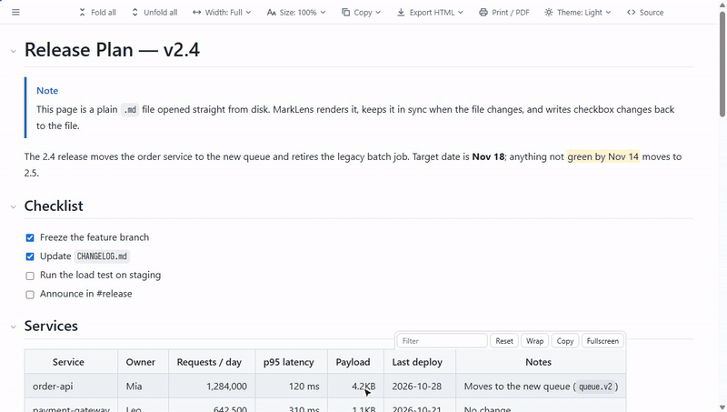
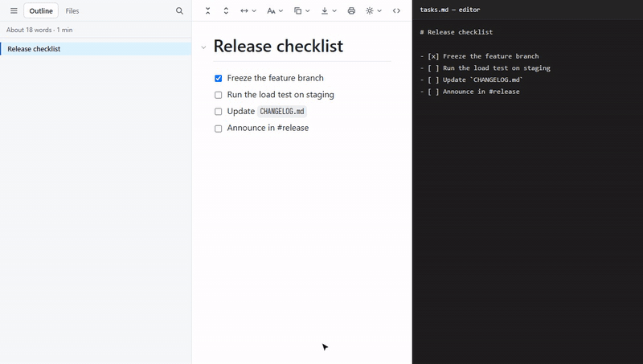
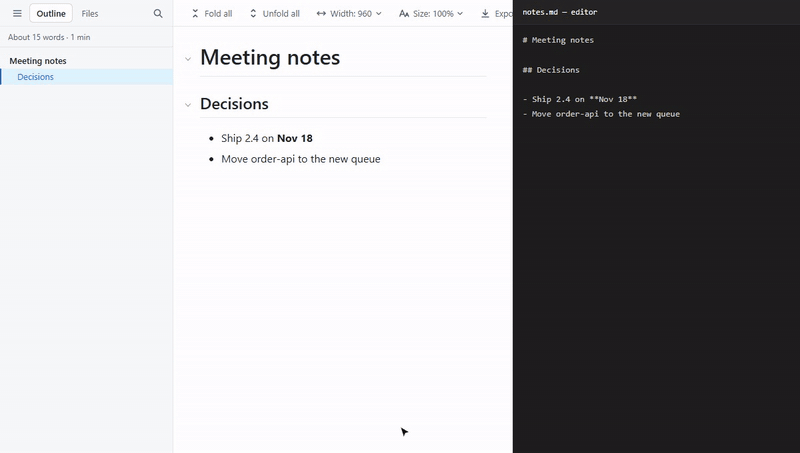
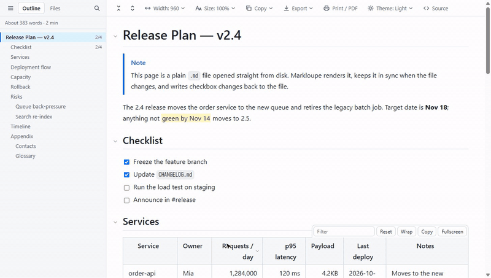
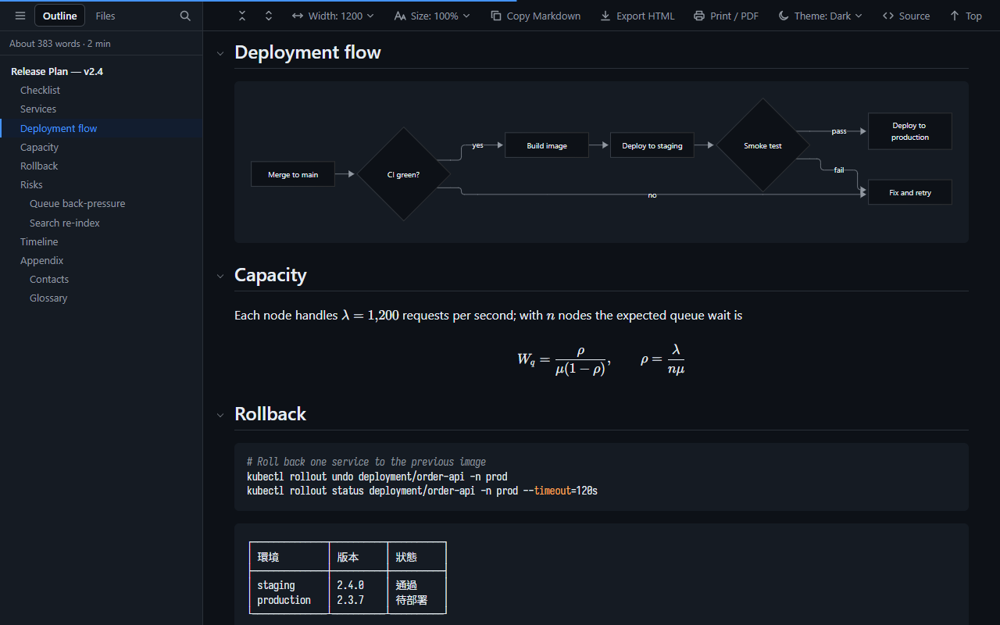

<p align="center">
  
</p>

<h1 align="center">Markloupe</h1>

<p align="center"><strong>A Markdown reader for Chrome and Edge, with tables you can actually use.</strong></p>

<p align="center">
  <a href="https://github.com/xjin9612/markloupe/releases/latest"></a>
  <a href="https://github.com/xjin9612/markloupe/actions/workflows/ci.yml"></a>
  <a href="LICENSE"></a>
  <a href="PRIVACY.md"></a>
</p>

<p align="center">English | <a href="README.zh-TW.md">繁體中文</a></p>

Open any `.md` file, on your computer or on the web. Read it with an outline and foldable sections. Sort and filter its tables, and check off tasks right in the file. Open source, no account, no data collected.



## Install

Markloupe works in Chrome and Edge on Windows, macOS and Linux.

1. Download `markloupe-vX.Y.Z.zip` from the [latest release](https://github.com/xjin9612/markloupe/releases/latest) and unzip it.
2. Open `chrome://extensions` (Edge: `edge://extensions`) and turn on **Developer mode**.
3. Click **Load unpacked** and select the unzipped `markloupe-vX.Y.Z` folder.
4. A welcome page opens. For files on your computer, follow it to turn on **Allow access to file URLs**.
5. To read `.md` files on websites, turn on **Also open .md files on websites** on the welcome page or in the popup.

Then drag any `.md` file into the browser, or open a `.md` link on the web. To upgrade, replace the folder with the new release. Then click the reload icon on the extensions page. See the [changelog](CHANGELOG.md) for what's new.

## Highlights

### Tables you can work with

- Drag column edges to resize.
- Click a header to sort. Numbers, sizes such as `4.2KB`, dates and Chinese text sort correctly.
- Filter rows as you type, or view a table fullscreen.
- Copy a table and paste it into Excel or Google Sheets.

### Check off tasks in your files

Click a task checkbox in a local `.md` file. Markloupe saves `[ ]` / `[x]` straight back to the file, and changes only that line. Undo from the notification. If the file changed elsewhere, Markloupe refuses to write.



### Live reload

Save the file in your editor and the page updates. Your scroll position, folded sections and table state stay as they were.



### Outline, folding and folders

The sidebar outline highlights the section you're reading. Fold any section, or all of them at once. The **Files** tab lists the Markdown files and subfolders next to the document.



### Diagrams, math and a dark theme

[KaTeX](https://katex.org/) math and [Mermaid](https://mermaid.js.org/) diagrams are drawn in local files and on web pages. Choose light, dark, or follow your system. Text diagrams in code blocks line up, even with Chinese, Japanese and Korean text.



### Print, PDF and HTML export

**Print / PDF** prints the whole document in light colors, with every section expanded. The margins show only a page number. **Export HTML** saves what you see as an HTML file. **Single file** embeds the images, so the file works on its own when you share it. **Link to images** keeps the file small.

In a **Single file** export, links to local files keep their relative paths, and links to `.md` files point to `.html`. Export the linked documents into the same folder, and the links work between the exported files. Heading anchors match only between files that Markloupe exported. **Link to images** turns local links into absolute `file://` addresses, which work only on your computer.

Add `lang` to the front matter (for example `lang: zh-TW`) to set the document language for the reader and the exported file.

## All features

**Reading**
- Sidebar outline that highlights the section you're reading, with heading search (`/`), word count and reading time
- Fold any section, or fold and unfold everything at once; Ctrl+F still finds text in folded sections
- Live reload for local files that keeps your scroll position, folds and table state
- Remembers where you stopped reading each file
- Relative `.md` links open in the reader; external links open in a new tab (can be turned off)
- Raw source view, one key away, with line numbers; click one to copy that line's location

**Tables**
- Drag to resize columns (double-click the handle to fit), click headers to sort (a third click restores the original order)
- Filter rows (tables with 5+ rows), wrap toggle, fullscreen with a sticky header
- Tables wider than the text column scroll sideways, with a shadow on the side that has more
- Copy as tab-separated text that pastes into a spreadsheet, or as Markdown that keeps the original formatting; download as CSV. All three follow the current sort and filter

**Markdown**
- CommonMark and GitHub Flavored Markdown: tables, task lists, footnotes, autolinks
- GitHub alerts (`> [!NOTE]`), `==highlight==`, emoji shortcodes (`:tada:`), collapsible front matter (its `lang` sets the document language)
- Docs-site containers (`::: tip`, `::: warning`, `::: details`, Docusaurus `:::note`) and definition lists
- Syntax highlighting with a language label, copy button and wrap toggle
- KaTeX math (`$…$`, `$$…$$`, `` $`…`$ ``, ` ```math `), on web pages too; click a formula to copy its LaTeX
- Mermaid diagrams; they follow the theme and can be switched back to source
- View a diagram fullscreen: scroll to zoom, drag to move, double-click to reset
- Images load as you scroll; click to zoom

**Local files**
- **Files** tab with folders first and natural sort (`2-…` before `10-…`); go up a folder with ↑, or right-click a folder → *Make this the top folder*
- Check off tasks and save them to the file, in nested lists, ordered lists and blockquotes; keeps CRLF line endings and BOM
- Optional **Edit** button: open the file in VS Code at the section you're reading. Other editors with a URL scheme work too

**Appearance**
- Light, dark, or follow the system; GitHub, sepia, high-contrast, soft green or graphite colors, or your own
- Add your own CSS to reading pages
- Sync settings to your other computers through your browser account (can be turned off)
- Text width (full, 1600, 1200, 960 or custom); tables and code can optionally grow to the right of the text column
- Font size scales the whole document, including code, tables, math and diagrams; adjustable line height
- Interface in English, Traditional Chinese and Simplified Chinese

**Sharing**
- Print or save as PDF, with sections expanded and only page numbers in the margins
- Export as HTML with styles, diagrams and math fonts embedded and no scripts. **Single file** also embeds the images. An image on a website is embedded only if that site allows it, or if **Also open .md files on websites** is on. Images that can't be read keep their address, and Markloupe tells you how many
- The **Copy** menu has two modes. **Copy content** copies the Markdown source with HTML formatting attached, so apps that accept formatted text keep the formatting. **Copy location** copies the path and line range, such as `D:\notes\report.md:142-168 (Causes)` on Windows or `/Users/you/notes/report.md:142-168 (Causes)` on macOS, so you can point an AI tool at the exact lines
- **Copy** in the toolbar works on the whole document; the copy button next to a heading works on that section
- Select text to copy its Markdown source or its location

## Keyboard shortcuts

On a reading page (ignored while typing in a text box):

| Key | Action |
|---|---|
| `t` | Show / hide the sidebar |
| `/` | Search headings (Outline tab) or file names (Files tab) |
| `[` / `]` | Fold all / unfold all |
| `n` / `p` | Next / previous heading |
| `w` | Cycle text width |
| `d` | Cycle theme: auto → light → dark (all tabs) |
| `+` (or `=`) / `-` / `0` | Larger / smaller / reset font size (all tabs) |
| `r` | Raw source / back to reading |

Browser-wide, changeable at `chrome://extensions/shortcuts`:

| Key | Action |
|---|---|
| `Alt+Shift+B` | Show / hide the sidebar (current tab) |
| `Alt+Shift+C` | Cycle text width (current tab) |
| `Alt+Shift+R` | Raw source / back to reading (current tab) |
| `Alt+Shift+D` | Cycle theme (all tabs) |

## Settings

Open the Markloupe icon in the toolbar for all settings.

- **Theme, colors, custom CSS, font size and line height** apply to every open tab right away.
- **Sidebar, its width, and text width** apply to the current tab only, so you can compare documents side by side. They're kept when you reload or open another file in the same tab.
- **Everything else** is the default for new tabs; open tabs pick it up after a reload.

## Privacy and security

Markloupe collects no data and sends none of it anywhere; its only network request is reloading the document you opened. At install it asks only for `storage` (your settings) and `scripting` (to register its scripts for websites); access to websites is up to you. It runs no remote code: every library is packaged inside the extension. HTML inside documents is filtered, and a test suite of 60+ attack samples checks that none of them can run code. Details: [privacy policy](PRIVACY.md), [security design](docs/DEVELOPMENT.md#安全設計) (in Traditional Chinese). Report vulnerabilities privately as described in [SECURITY.md](SECURITY.md).

## FAQ

**A `.md` file on a website shows as plain text.**<br>
Markloupe doesn't ask for access to websites when installed. Turn on **Also open .md files on websites** in the popup, then reload the page.

**When I turn on the website option, Chrome says Markloupe can "read and change your data on all websites". Why?**<br>
Markloupe only runs on addresses that end in `.md`, `.markdown`, `.mkd` or `.mdx`. Chrome's permission prompt ignores the part of the address after the site name, so it shows all websites. To limit it, open the extension's **Details** page and set **Site access** to *On specific sites*. Local files are not affected.

**A local `.md` file shows as plain text.**<br>
Turn on **Allow access to file URLs** on the extension's **Details** page, then reload the file. The welcome page (Markloupe icon → **?**) walks you through it.

**Checking a box asks for folder access.**<br>
The first time, pick a top-level folder such as `D:\Projects` or `~/Projects`. Every `.md` under it becomes writable. After a restart, Chrome asks again unless you chose **Allow on every visit**. Manage folders from the Markloupe icon → **Manage folders**. Files that aren't UTF-8 (such as Big5) display normally, but their checkboxes are read-only.

**Files on WSL or a network share: the Files tab says it isn't supported.**<br>
Chrome doesn't let extensions read files whose address has a host name, such as `file://wsl.localhost/…` or `file://server/share/…`. The document displays normally, but the Files tab, auto-reload and saving checked tasks don't work there. To use them, keep the file on a local drive, for example under `D:\` or in your home folder.

**Text diagrams in code blocks don't line up perfectly.**<br>
Markloupe scales the system font so Chinese, Japanese and Korean characters are exactly two columns wide. That makes them look slightly larger. For the best result, install [Sarasa Gothic](https://github.com/be5invis/Sarasa-Gothic):

1. From its releases, download **Single Family TTF Package → Mono**.
2. Install `SarasaMonoTC-Regular`, `-Bold` and `-Italic`.
3. Open `chrome://restart` to restart Chrome. Markloupe uses the font automatically.

**Search with Ctrl+F doesn't find text in folded sections of a very large file.**<br>
In documents with more than 3,000 top-level blocks (around 400 KB), Markloupe hides folded sections in a faster way. Ctrl+F can't see them. Unfold them first (`]`).

**I want my own colors.**<br>
Set **Colors** to *Custom* and pick the background, text and accent colors for the light and dark themes. You can type color codes such as `#1e1e2e`. Markloupe works out the other colors. When the text color has 4.5:1 contrast with the background, secondary text, code colors and alert titles get at least 4.5:1 too. The popup warns when the text or accent color falls below 4.5:1.

For finer control, keep **Colors** on *GitHub* and override the color variables in **Custom CSS**. This example changes the dark theme only:

```css
html.markloupe[data-ml-theme="dark"] { --bg: #1e1e2e; --fg: #cdd6f4; --link: #89b4fa; }
```

Use `light` instead of `dark` for the light theme. [`src/shared/tokens.css`](src/shared/tokens.css) lists every variable, such as `--code-bg` for code blocks and `--hl-keyword` for code colors.

## Contributing

Bug reports and ideas are welcome in [issues](https://github.com/xjin9612/markloupe/issues). Development docs (in Traditional Chinese): [docs/DEVELOPMENT.md](docs/DEVELOPMENT.md).

## License

MIT. Third-party licenses are in `vendor/licenses/`. Mermaid's bundle also includes dependencies such as D3 and DOMPurify, each under its own license.
