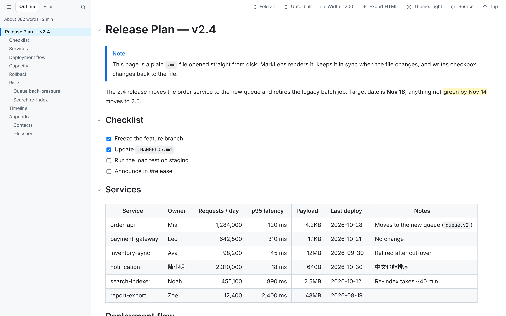
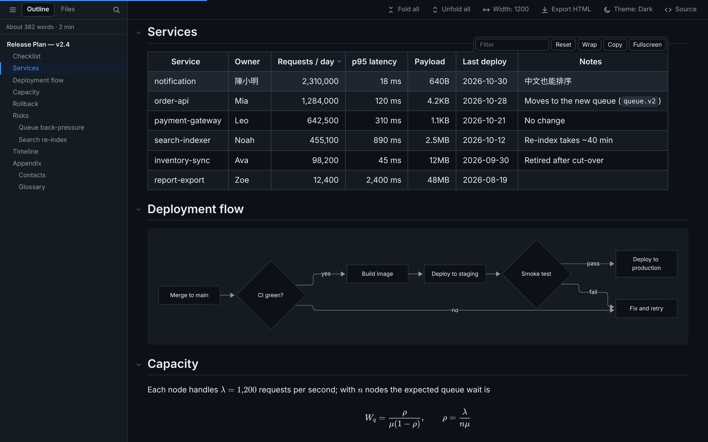

<p align="center">
  
</p>

# MarkLens

[](https://github.com/xjin9612/marklens/actions/workflows/ci.yml)
[](https://github.com/xjin9612/marklens/releases/latest)

English | [繁體中文](./README.zh-TW.md)

A lightweight, auditable Markdown reader for Chrome and Edge. Open any `.md` file — local or online — and read it with a sidebar outline, foldable sections, and tables you can actually work with: resize columns, sort, filter, and copy to a spreadsheet.





Inspired by [md-reader 2.x](https://github.com/md-reader/md-reader) (MIT); rewritten from scratch with three goals: **easy to audit, no remote code, no build step**.

## Install

1. Download `marklens-vX.Y.Z.zip` from the [latest release](https://github.com/xjin9612/marklens/releases/latest) and unzip it (or clone this repository).
2. Open `chrome://extensions` (Edge: `edge://extensions`) and turn on **Developer mode**.
3. Click **Load unpacked** and select the unzipped `marklens-vX.Y.Z` folder (the one containing `manifest.json`).
4. For local files: open the extension's **Details** and enable **Allow access to file URLs**. A welcome page opens after installing and walks you through this.

To upgrade, replace the folder with the new release and click the reload icon on the extensions page. See [CHANGELOG.md](./CHANGELOG.md) for what changed.

## Features

| Area | What you get |
|---|---|
| Pages | Renders `.md` `.markdown` `.mkd` `.mdx` over `http(s)://` and `file://`; only takes over when the browser shows the file as plain text |
| Files | Local files: a **Files** tab lists the Markdown files and subfolders next to the document (folders first, natural sort); subfolders load when opened; ↑ goes up a folder and right-click → *Make this the top folder* goes back down. Skipped names are configurable |
| Toolbar | Sticky top bar: sidebar (☰), fold all, unfold all, text width, export HTML, theme, raw source / back to reading, back to top |
| Editor | Optional **Edit** button opens the local file in VS Code at the section you're reading, or in any editor that has a URL scheme (custom template with `{path}` and `{line}`). Notepad and Notepad++ can't be opened from a browser |
| Export | Save the current view as one self-contained HTML file (styles, diagrams and math fonts embedded, sections expanded, no JavaScript) to share with people who don't have MarkLens |
| Layout | Text column width: full / 1600 / 1200 / 960 / custom. Tables and code blocks can grow past the text column up to the page edge. Adjustable font size and line height; reading progress bar |
| Sidebar | ☰ or `t` to show / hide. **Outline** tab: active-section highlight, heading search (`/`), resizable width, two-line titles, folded-section markers, word count and reading time. How many heading levels the outline shows is set in the popup |
| Folding | Fold any section from the ▾ next to its heading. "Fold all" starts from the first heading level that has two or more headings. Folded content stays searchable with Ctrl+F and unfolds on match (in very large documents — roughly 400 KB+ — folded sections are hidden normally for speed and must be unfolded before searching) |
| Tables | **Drag to resize columns** (double-click the handle to auto-fit), **click headers to sort** (numbers with thousands separators, byte units, dates, CJK text; empty cells last; third click restores the original order), row filter (5+ rows), copy as TSV (paste straight into Excel), wrap toggle, fullscreen with sticky header. The table toolbar only appears on hover |
| Syntax | CommonMark + GFM, task lists, footnotes, `==highlight==`, emoji shortcodes (`:tada:`), GitHub alerts (`> [!NOTE]` etc.), collapsible front matter |
| Code | highlight.js syntax highlighting (common languages), language label, copy button, per-block wrap toggle |
| Diagrams | [Mermaid](https://mermaid.js.org/) flowcharts, sequence diagrams and more in local files. The library (~5 MB) loads only when a document contains a mermaid block; diagrams follow the theme, keep their place during live reload, and can be toggled back to source. Syntax errors are shown next to the source. Not drawn on `http(s)://` pages (see Security) |
| Math | `$…$`, `$$…$$`, `` $`…`$ `` and ` ```math ` blocks rendered with [KaTeX](https://katex.org/) in local files; loaded only when a document contains math. Prices like `$5 and $10` stay as text. Like Pandoc and GitHub, `$HOME/$USER` would be read as math — put it in backticks or write `\$` |
| Images | Lazy loading, click to zoom (Esc to close) |
| Theme | Auto (follows the system) / light / dark, from the toolbar, the `d` key or the popup; applies to every open tab |
| Check off tasks | Click a task-list checkbox in a local file to save `[ ]` / `[x]` straight back to the file — no editor needed. Works in nested lists, ordered lists and blockquotes; checkboxes inside code blocks are never touched. Undo from the toast; refuses to write if the file changed elsewhere; keeps CRLF and BOM. Requires authorizing a folder once (see below) |
| Live reload | Local files are checked every second and re-rendered only when changed — scroll position, folds, and table sort / widths / filters are preserved |
| Language | English and Traditional Chinese interface. Follows the browser language by default, or pick one in the popup → **Language** |
| Misc | External links open in a new tab (can be turned off), remembers reading position per file, print stylesheet, relative `.md` links open in the reader |

### Checking off tasks in local files

1. Click any checkbox in a local `.md` file. The first time, MarkLens asks you to authorize the folder: pick a top-level folder such as `D:\Projects` and every `.md` under it becomes writable.
2. After that, a click saves the change immediately; use **Undo** on the toast to revert.
3. After Chrome restarts, you may be asked to confirm access again. Choose **Allow on every visit** in Chrome's prompt to skip this.

Folder access is held by the extension itself (in its own storage, under its own origin). Ordinary web pages — including local HTML files — cannot reach it. Manage folders from the popup → **Manage folders**.

### Per-tab vs. global settings

- **Current tab only**: sidebar visibility, sidebar width, selected sidebar tab, text width, and the Files tab's top folder and open folders. Kept across reloads and when opening another file in the same tab, cleared when the tab closes — handy for comparing documents side by side. Raw view and folds are not kept. On web pages these stay in memory only (not in the site's storage, so the site can't detect MarkLens) and reset on reload.
- **Synced live to every tab**: theme, font size, line height.
- **Everything else in the popup** is the default for new tabs; open tabs pick it up after a reload. Dragging the sidebar width also saves it as the new default.

### Keyboard shortcuts

On a reading page (ignored while typing in an input):

| Key | Action |
|---|---|
| `t` | Show / hide sidebar |
| `r` | Raw source / back to reading |
| `w` | Cycle text width |
| `/` | Search headings (Outline tab) or file names (Files tab) |
| `d` | Cycle theme: auto → light → dark (all tabs) |
| `[` / `]` | Fold all / unfold all |

Browser-level (change them at `chrome://extensions/shortcuts`):

| Key | Action |
|---|---|
| `Alt+Shift+B` | Show / hide sidebar (current tab) |
| `Alt+Shift+C` | Cycle text width (current tab) |
| `Alt+Shift+R` | Raw source / back to reading (current tab) |
| `Alt+Shift+D` | Cycle theme (all tabs) |

## Security

- **Allow-list HTML sanitizer** (`src/content/sanitize.js`): keeps common tags such as `<details>`, `<kbd>` and tables; drops `<script>`, `<iframe>`, `<svg>`, every event-handler attribute, `style` (except table alignment), and `javascript:` / non-image `data:` URLs.
- **Math** renders with KaTeX `trust: false` (no `\href`, `\url`, `\includegraphics` or `\html…` commands) and a macro-expansion limit; like Mermaid, its files are reachable from `file://` pages only.
- **No borrowing the interface**: HTML in a document cannot use MarkLens's own `ml-` class or id names (so it cannot draw a fake overlay or prompt over the page), and `name` is kept only on `<a>` to prevent DOM clobbering.
- **Exported HTML** contains no JavaScript and carries a Content-Security-Policy that blocks scripts, so a shared export is safe to open.
- **Attack suite**: `test/fixtures/security.md` collects 60+ attack samples; the tests render it, click every link and diagram node, and fail if anything runs.
- **Minimal permissions**: only `storage`. Content scripts match Markdown file extensions only — no "read all sites" permission.
- **Local file reads** go through the background worker, which only reads the URL of the page that asked.
- **Folder listings** for the Files tab are also read by the background worker: only `file://` folders (no network shares, no `.` / `..` segments), returning only Markdown file names and subfolder names — never file contents.
- **Writes** happen only when you click a task checkbox: the background worker changes that single line after checking that the file still matches what the page shows. Which lines are writable is decided by the Markdown parser with a per-render random nonce, so HTML inside a document cannot fake a writable checkbox.
- **Mermaid** renders with `securityLevel: 'strict'` (labels sanitized by DOMPurify, click handlers disabled). Its files must be web-accessible so they can be loaded on demand; access is limited to `file://` pages so ordinary websites cannot probe for them to detect that MarkLens is installed. That is also why diagrams are only drawn in local files.
- **No remote code**: third-party libraries are pinned in `vendor/`; nothing is fetched or auto-updated at runtime.

## Project layout

```
manifest.json
_locales/                interface text: en (default) and zh_TW
src/
  background.js          shortcuts, local file reads, folder listings, task write-back
  shared/settings.js     settings defaults and storage (shared by all contexts)
  shared/i18n.js         interface text lookup (strings live in _locales/)
  shared/roots.js        authorized folders (extension origin only)
  shared/tokens.css      design tokens (colors, fonts, motion) shared by the reader and extension pages
  shared/theme.js        applies the theme setting to the popup, welcome and folder pages
  grant/                 folder authorization page
  welcome/               first-run welcome page
  content/
    early.js             runs first: keeps the previous page on screen while switching files, loading background color
    util.js              helpers, reading the page source
    icons.js             interface line icons (SVG)
    fonts.js             CJK/ASCII width alignment for code blocks
    sanitize.js          allow-list HTML sanitizer
    markdown.js          markdown-it setup, ==mark==, alerts, front matter
    enhance.js           heading anchors & folding, inline grouping, task lists, code blocks, images, stats
    mermaid.js           Mermaid diagrams, loaded on demand
    math.js              KaTeX math, loaded on demand
    export.js            export the current view as a self-contained HTML file
    table.js             column resize, sorting, filter, copy, fullscreen, state save/restore
    toc.js               sidebar: Outline / Files tabs, search
    files.js             Files tab: folder listing, lazy subfolders
    main.js              entry point: layout, toolbar, shortcuts, per-tab state, live reload, task write-back
    content.css          all styles (scoped under html.marklens)
  popup/                 settings popup
vendor/                  third-party libraries (versions in VERSIONS.md, licenses in licenses/)
scripts/vendor.mjs       script for upgrading vendor/
scripts/release.mjs      release helper: version check, release notes, packaging
scripts/screenshots.mjs  regenerates docs/screenshots/ from docs/demo.md (npm run screenshots)
scripts/manual-bigfile.mjs  generates the large file for the manual tests (npm run manual:bigfile)
docs/                    README screenshots and the demo document they are taken from
.github/workflows/       CI tests and automated releases
CHANGELOG.md             release notes (the source for GitHub releases)
test/                    end-to-end tests (e2e.mjs), visual regression tests (visual.mjs) and fixtures
test/visual/<platform>/  visual baselines, one folder per OS
test/manual/             manual test checklist (Traditional Chinese)
package.json             dev tooling only (tests, vendor updates); the extension itself needs no build
```

### Box-drawing tables in code blocks

Text diagrams such as `┌─┬─┐` only line up when CJK characters are exactly twice as wide as ASCII. System monospace fonts (Consolas, Menlo…) have no CJK glyphs, so the browser falls back to a CJK font of a different width. MarkLens measures the actual widths and scales the system CJK font for code blocks (`@font-face` `size-adjust`, CJK ranges only) so mixed tables align without installing anything; CJK characters in code look slightly larger as a result. For the best-looking result, install [Sarasa Gothic](https://github.com/be5invis/Sarasa-Gothic); MarkLens uses **Sarasa Mono TC** automatically when present.

The full release is several hundred MB, but only a few files are needed:

1. On the [releases page](https://github.com/be5invis/Sarasa-Gothic/releases), download **Single Family TTF Package → Mono → zip** (the hinted *Download* link; *Unhinted* is meant for high-DPI screens and macOS).
2. From the archive, install only the TC (Traditional Chinese) files:

   | File | Purpose |
   |---|---|
   | `SarasaMonoTC-Regular.ttf` | Regular text (required) |
   | `SarasaMonoTC-Bold.ttf` | Bold (required) |
   | `SarasaMonoTC-Italic.ttf` | Code comments are italic; without it the browser slants the regular glyphs |
   | `SarasaMonoTC-BoldItalic.ttf` | Optional, rarely used |

3. Select the files → right-click → **Install for all users**, then fully restart Chrome — Chrome keeps running in the background after its windows close, so open `chrome://restart` instead of just closing the window.

## Upgrading third-party libraries

Edit the version table in `scripts/vendor.mjs`, then run:

```bash
npm run vendor
```

## Tests

```bash
npm install                          # installs playwright only (dev)
npx playwright install chromium      # first time only
npm test
```

The suite loads the extension into Chromium and opens local and http fixtures (`test/fixtures/sample.md`), covering:

- Rendering: GFM, task lists (tight and loose), footnotes, alerts, front matter, code highlighting, emoji shortcodes, GitHub-style autolinks
- Loading: switching files keeps the previous page until the new one is rendered (no blank page, no "Loading…" in the Files tab), loading background follows the last theme, raw text shown normally when MarkLens is turned off; non-Markdown URLs left alone
- Security: scripts, event handlers, `javascript:` links, style attributes; plus the attack suite in `test/fixtures/security.md` (dangerous tags and URLs, encoding tricks, DOM clobbering, fake interface, file names, Mermaid)
- Layout: text column width, wide tables beyond the text column, small tables at every width, narrow-screen drawer sidebar
- Tables: sorting (numbers / bytes / dates), column resize, filter, fullscreen and Esc, state kept across live reload
- Folding: fold / unfold all, Ctrl+F reveal, outline markers, outline links and `#hash` URLs into folded sections
- Sidebar: menu button position, `/` search, Files tab (natural sort, skipped folders, lazy subfolders, top folder kept across files, parent folder button, folder listing restrictions)
- Tabs: sidebar and width stay per tab, appearance syncs live, new tabs use updated defaults, `Alt+Shift` shortcuts, reading position remembered
- Links: external links open in a new tab (and the setting to turn it off); editor button and its URL template restrictions
- Accessibility: every button has a spoken name, keyboard focus outline, controls at least 24×24 px, sorting tables and enlarging images from the keyboard
- Task write-back: correct line (with front matter), blockquote and ordered lists, undo, conflict detection, CRLF and BOM preserved, unauthorized folder, feature off, non-UTF-8 files (including the real Big5 document from the manual tests: it renders without replacement characters and its checkboxes explain why they are read-only). Folder access is simulated with the browser's private file system (OPFS); the folder picker itself has to be tested by hand
- Mermaid (`test/fixtures/mermaid.md`): not loaded without diagrams, drawing, syntax errors, label injection and click handlers, source toggle, theme switch, no flicker on live reload, not drawn over http, setting off
- Math (`test/fixtures/math.md`): inline, display, ` ```math `, tables, prices and escapes left alone, errors, live reload, not drawn over http, setting off
- Export: single file without scripts, sections expanded, styles and checkbox states kept, math fonts embedded
- Interface language: matching keys in both locales, language override, English UI smoke test
- Welcome page on install, popup settings, notice in open tabs after the extension is reloaded

Screenshots go to the directory in the `SHOT_DIR` environment variable (system temp by default).

### Visual regression tests

```bash
npm run test:visual                  # compare with the baselines
npm run test:visual -- --update      # accept the current look as the new baseline
```

Takes screenshots of a fixed set of views (reader light / dark / narrow, Files tab, Mermaid in dark mode, popup, welcome page) and compares them pixel by pixel with `test/visual/<platform>/`. Fonts differ between operating systems, so each OS keeps its own baselines; the first run on a new OS creates them. A view fails when more than 0.1% of its pixels differ (`VISUAL_TOLERANCE` to change); the diff images (changed pixels in red) go to `ml-visual/` under `SHOT_DIR`. After an intended UI change, check the diffs, then run with `--update` and commit the new baselines. Not part of CI.

### Manual tests

Some things can't be automated: the folder picker, permission prompts after a Chrome restart, opening VS Code, and how fonts and diagrams actually look. `test/manual/` (in Traditional Chinese) is a checklist to run in your own Chrome before a release:

1. `npm run manual:bigfile` once, to generate the ~1 MB performance file (not committed).
2. Reload MarkLens on `chrome://extensions`, then open `test/manual/00-說明.md` and work through the files; the sidebar's **Files** tab moves between them.
3. Checking boxes writes to these files, so restore them afterwards: `git restore test/manual`.

## Releasing

1. Add a `## [X.Y.Z] - YYYY-MM-DD` section at the top of `CHANGELOG.md` (move items from *Unreleased*).
2. Set the same version in `manifest.json` (`version` and `version_name`) and `package.json`.
3. Check locally: `node scripts/release.mjs check vX.Y.Z`
4. Commit, then `git tag vX.Y.Z` and `git push origin main --tags`.

The **Release** workflow verifies that the tag, `manifest.json`, `package.json` and `CHANGELOG.md` agree, runs the tests, packages `marklens-vX.Y.Z.zip` (extension files only) and publishes a GitHub release using that CHANGELOG section as the notes. Every push to `main` and every pull request runs the tests through the **Tests** workflow.

## Roadmap

- Chrome Web Store / Edge Add-ons listing
- More interface languages

## License

MIT. Third-party licenses are in `vendor/licenses/` (Mermaid's bundle also includes its own dependencies such as D3 and DOMPurify, under their respective licenses).
