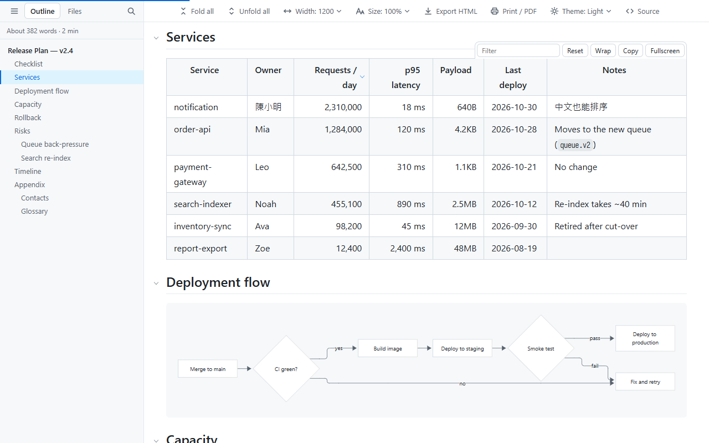
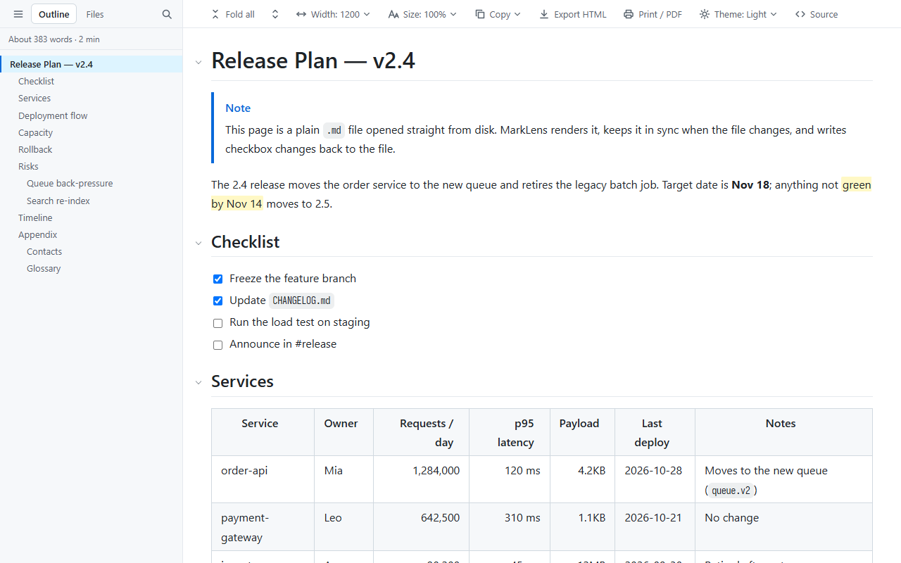
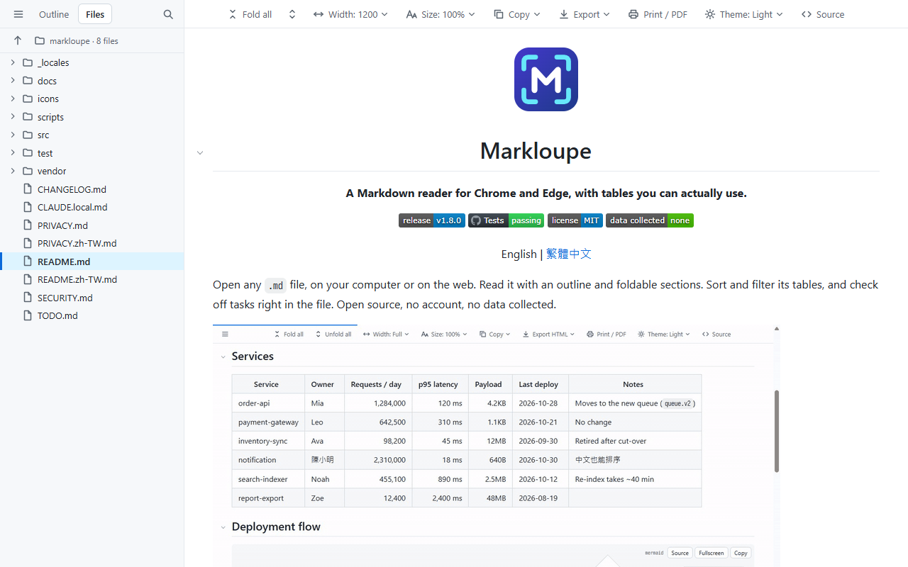

<p align="center">
  
</p>

<h1 align="center">MarkLens</h1>

<p align="center"><strong>A Markdown reader for Chrome and Edge, with tables you can actually use.</strong></p>

<p align="center">
  <a href="https://github.com/xjin9612/marklens/releases/latest"></a>
  <a href="https://github.com/xjin9612/marklens/actions/workflows/ci.yml"></a>
  <a href="LICENSE"></a>
  <a href="PRIVACY.md"></a>
</p>

<p align="center">English | <a href="README.zh-TW.md">繁體中文</a></p>

Open any `.md` file, on your computer or on the web, and read it with an outline, foldable sections, Mermaid diagrams and math. Sort and filter its tables, check off tasks right in the file, and print or export what you see. Open source, no account, no data collected.

## Install

1. Download `marklens-vX.Y.Z.zip` from the [latest release](https://github.com/xjin9612/marklens/releases/latest) and unzip it.
2. Open `chrome://extensions` (Edge: `edge://extensions`), turn on **Developer mode**, click **Load unpacked** and select the unzipped `marklens-vX.Y.Z` folder.
3. A welcome page opens. For files on your computer, follow it to turn on **Allow access to file URLs**.

Then drag any `.md` file into the browser, or open a `.md` link on the web. To upgrade, replace the folder with the new release and click the reload icon on the extensions page. See the [changelog](CHANGELOG.md) for what's new.

## Highlights

### Tables you can work with

Drag column edges to resize, click a header to sort (numbers, sizes such as `4.2KB`, dates and Chinese text all sort correctly), filter rows as you type, view a table fullscreen, and copy it straight into Excel or Google Sheets.



### Check off tasks in your files

In a local `.md` file, click a task checkbox and `[ ]` / `[x]` is saved straight back to the file. No editor needed. Undo from the notification; MarkLens refuses to write if the file changed elsewhere, and only the line you clicked is touched.



### Browse a folder

The **Files** tab lists the Markdown files and subfolders next to the document, so you can read through a whole project or notes folder. Free, no account.



### Diagrams, math and a dark theme

[Mermaid](https://mermaid.js.org/) diagrams and [KaTeX](https://katex.org/) math in local files, in a light or dark theme that can follow your system. Text diagrams in code blocks line up even with Chinese, Japanese and Korean text.


### Print, PDF and HTML export

**Print / PDF** prints the whole document with every section expanded, in light colors, with only a page number in the margins. **Export HTML** saves what you see as one self-contained file to share with people who don't have MarkLens.

## All features

**Reading**
- Sidebar outline that highlights the section you're reading, with heading search (`/`), word count and reading time
- Fold any section, or fold and unfold everything at once; Ctrl+F still finds text in folded sections
- Live reload for local files that keeps your scroll position, folds and table state
- Remembers where you stopped reading each file
- Relative `.md` links open in the reader; external links open in a new tab (can be turned off)
- Raw source view, one key away

**Tables**
- Drag to resize columns (double-click the handle to fit), click headers to sort (a third click restores the original order)
- Filter rows (tables with 5+ rows), wrap toggle, fullscreen with a sticky header
- Copy as tab-separated text that pastes into a spreadsheet

**Markdown**
- CommonMark and GitHub Flavored Markdown: tables, task lists, footnotes, autolinks
- GitHub alerts (`> [!NOTE]`), `==highlight==`, emoji shortcodes (`:tada:`), collapsible front matter
- Syntax highlighting with a language label, copy button and wrap toggle
- Mermaid diagrams and KaTeX math (`$…$`, `$$…$$`, `` $`…`$ ``, ` ```math `) in local files; diagrams follow the theme and can be switched back to source
- Images load as you scroll; click to zoom

**Local files**
- **Files** tab with folders first and natural sort (`2-…` before `10-…`); go up a folder with ↑, or right-click a folder → *Make this the top folder*
- Check off tasks and save them to the file, in nested lists, ordered lists and blockquotes; keeps CRLF line endings and BOM
- Optional **Edit** button: open the file in VS Code at the section you're reading, or in any editor with a URL scheme

**Appearance**
- Light, dark, or follow the system
- Text width (full, 1600, 1200, 960 or custom); tables and code can grow past the text column
- Font size scales the whole document, including code, tables, math and diagrams; adjustable line height
- Interface in English and Traditional Chinese

**Sharing**
- Print or save as PDF, with sections expanded and only page numbers in the margins
- Export as a single HTML file with styles, diagrams and math fonts embedded and no scripts

## Keyboard shortcuts

On a reading page (ignored while typing in a text box):

| Key | Action |
|---|---|
| `t` | Show / hide the sidebar |
| `/` | Search headings (Outline tab) or file names (Files tab) |
| `[` / `]` | Fold all / unfold all |
| `w` | Cycle text width |
| `d` | Cycle theme: auto → light → dark (all tabs) |
| `+` (or `=`) / `-` / `0` | Larger / smaller / reset font size (all tabs) |
| `r` | Raw source / back to reading |

Browser-wide, changeable at `chrome://extensions/shortcuts`:

| Key | Action |
|---|---|
| `Alt+Shift+B` | Show / hide the sidebar (current tab) |
| `Alt+Shift+C` | Cycle text width (current tab) |
| `Alt+Shift+R` | Raw source / back to reading (current tab) |
| `Alt+Shift+D` | Cycle theme (all tabs) |

## Settings

Open the MarkLens icon in the toolbar for all settings.

- **Theme, font size and line height** apply to every open tab right away.
- **Sidebar, its width, and text width** apply to the current tab only, so you can compare documents side by side. They're kept when you reload or open another file in the same tab.
- **Everything else** is the default for new tabs; open tabs pick it up after a reload.

## Privacy and security

MarkLens collects no data and sends none of it anywhere; its only network request is reloading the document you opened. It asks for a single permission, `storage`, for your settings, and runs no remote code: every library is packaged inside the extension. HTML inside documents is filtered, and a test suite of 60+ attack samples checks that none of them can run code. Details: [privacy policy](PRIVACY.md), [security design](docs/DEVELOPMENT.md#安全設計) (in Traditional Chinese).

## FAQ

**Chrome says MarkLens can "read and change your data on all websites". Why?**<br>
MarkLens only runs on addresses that end in `.md`, `.markdown`, `.mkd` or `.mdx`, but Chrome's permission prompt ignores the part of the address after the site name. To limit it further, open the extension's **Details** page and set **Site access** to *On specific sites*. Local files are not affected.

**A local `.md` file shows as plain text.**<br>
Turn on **Allow access to file URLs** on the extension's **Details** page, then reload the file. The welcome page (MarkLens icon → **Help**) walks you through it.

**Diagrams and math aren't drawn on web pages.**<br>
They're drawn only for files opened from your computer: MarkLens keeps its diagram and math libraries away from websites so that sites can't detect it's installed. A note above the source explains this; save the file and open it locally to see the diagram.

**Checking a box asks for folder access.**<br>
The first time, pick a top-level folder such as `D:\Projects`; every `.md` under it becomes writable. After Chrome restarts it may ask again; choose **Allow on every visit** to skip that. Manage folders from the MarkLens icon → **Manage folders**. Files that aren't UTF-8 (such as Big5) display normally, but their checkboxes are read-only.

**Text diagrams in code blocks don't line up perfectly.**<br>
MarkLens scales the system font so Chinese, Japanese and Korean characters are exactly two columns wide, which makes them look slightly larger. For the best result, install [Sarasa Gothic](https://github.com/be5invis/Sarasa-Gothic): from its releases, download **Single Family TTF Package → Mono**, install `SarasaMonoTC-Regular`, `-Bold` and `-Italic`, then restart Chrome via `chrome://restart`. MarkLens uses it automatically.

**Search with Ctrl+F doesn't find text in folded sections of a very large file.**<br>
In documents larger than about 400 KB, folded sections are hidden in a faster way that Ctrl+F can't see. Unfold them first (`]`).

## Contributing

Bug reports and ideas are welcome in [issues](https://github.com/xjin9612/marklens/issues). Development docs (in Traditional Chinese): [docs/DEVELOPMENT.md](docs/DEVELOPMENT.md).

## License

MIT. Third-party licenses are in `vendor/licenses/` (Mermaid's bundle also includes its own dependencies such as D3 and DOMPurify, under their respective licenses).
