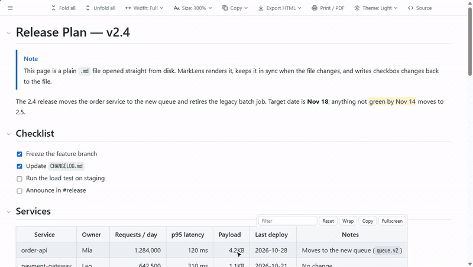
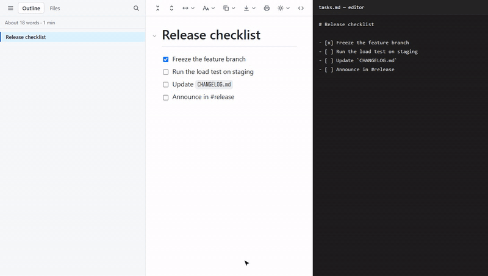
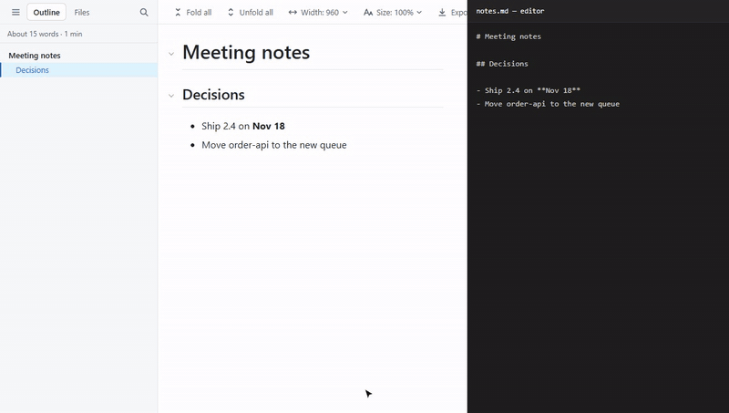
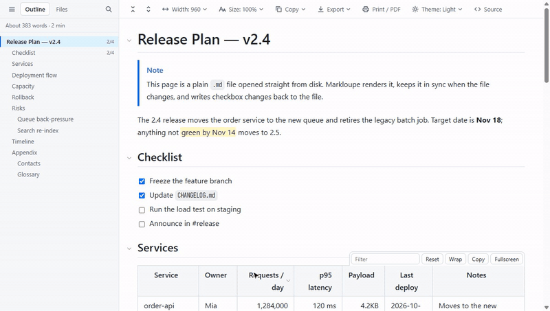
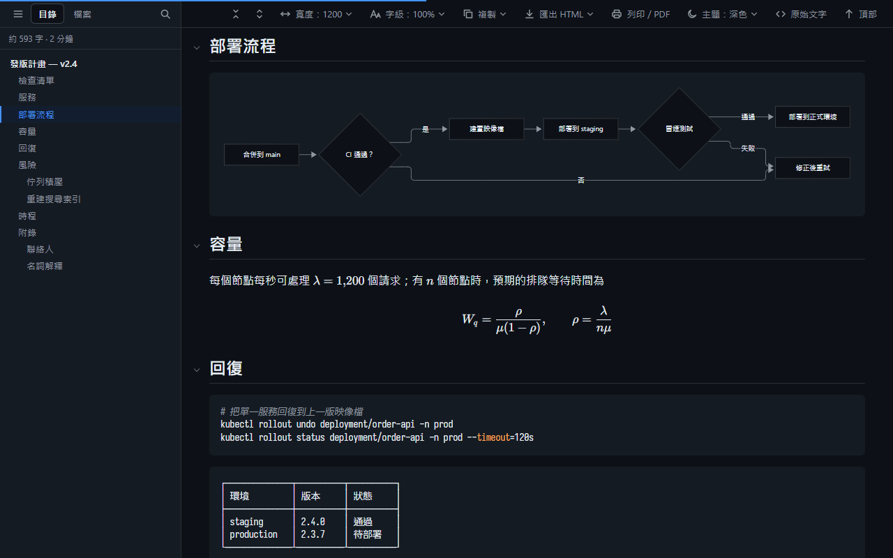

<p align="center">
  
</p>

<h1 align="center">Markloupe</h1>

<p align="center"><strong>表格真的能用的 Markdown 閱讀器，支援 Chrome 與 Edge。</strong></p>

<p align="center">
  <a href="https://github.com/xjin9612/markloupe/releases/latest"></a>
  <a href="https://github.com/xjin9612/markloupe/actions/workflows/ci.yml"></a>
  <a href="LICENSE"></a>
  <a href="PRIVACY.zh-TW.md"></a>
</p>

<p align="center"><a href="README.md">English</a> | 繁體中文</p>

在瀏覽器中開啟任何 `.md` 檔案，本機或網路上的都可以。側邊欄有目錄，段落可以摺疊。表格可以排序、篩選，任務可以直接勾選存回檔案。開源、不用帳號、不收集任何資料。



## 安裝

Markloupe 支援 Windows、macOS、Linux 上的 Chrome 與 Edge。

1. 從[最新版本](https://github.com/xjin9612/markloupe/releases/latest)下載 `markloupe-vX.Y.Z.zip` 並解壓縮。
2. 開啟 `chrome://extensions`（Edge：`edge://extensions`），打開「開發人員模式」。
3. 按「載入未封裝項目」，選擇解壓縮出來的 `markloupe-vX.Y.Z` 資料夾。
4. 安裝後會開啟歡迎頁。要開啟電腦上的檔案，請照著它打開「允許存取檔案網址」。
5. 要閱讀網路上的 `.md`，在歡迎頁或 Markloupe 圖示的設定中開啟「也在網頁上的 .md 檔案啟用」。

之後把 `.md` 檔拖進瀏覽器，或開啟網路上的 `.md` 連結即可。升級時用新版資料夾取代舊的。再到擴充功能頁按重新載入圖示。各版本的變更見[更新紀錄](CHANGELOG.md)（英文）。

## 特色

### 表格真的能用

- 拖拉欄位邊緣調整寬度。
- 點表頭排序。數字、`4.2KB` 這類容量、日期、中文都能正確排序。
- 邊打字邊篩選資料列，也能全螢幕檢視。
- 複製表格，直接貼到 Excel 或 Google 試算表。

### 直接勾選檔案中的任務

在本機 `.md` 檔點任務的勾選框，`[ ]`／`[x]` 會立即存回檔案。Markloupe 只修改你點的那一行。提示列上可以復原。檔案已在別處被修改時，Markloupe 會拒絕寫入。



### 自動更新

在編輯器存檔，閱讀頁就會更新。捲動位置、摺疊狀態與表格設定都會保留。



### 目錄、摺疊與資料夾

側邊欄目錄會標示目前閱讀的章節。任何段落都能摺疊，也能一次全部摺疊。「檔案」分頁列出同一資料夾的 Markdown 檔案與子資料夾。



### 圖表、數學公式與深色主題

[KaTeX](https://katex.org/) 數學公式與 [Mermaid](https://mermaid.js.org/) 圖表，本機檔案與網頁上都能繪製。主題可選淺色、深色或跟隨系統。程式碼區塊中的框線字元表格，中日韓文字也能對齊。



### 列印、PDF 與匯出 HTML

「列印／PDF」以淺色印出整份文件，所有段落都會展開。頁邊只印頁碼。「匯出 HTML」把目前的畫面存成 HTML 檔。選「單一檔」會內嵌圖片，分享時只要給一個檔案。選「圖片保留連結」，檔案比較小。

選「單一檔」時，指向本機檔案的連結保留相對路徑，連到 `.md` 的連結改成 `.html`。把連到的文件也匯出到同一個資料夾，匯出檔之間就能互相連結。標題錨點只在都由 Markloupe 匯出的檔案之間對得上。選「圖片保留連結」時，本機連結改成 `file://` 絕對網址，只在你自己的電腦上有效。

在 front matter 寫 `lang`（例如 `lang: zh-TW`），可以設定閱讀頁與匯出檔的文件語言。

## 完整功能

**閱讀**
- 側邊欄目錄：標示目前閱讀的章節，可搜尋標題（`/`），顯示字數與閱讀時間
- 任何段落都能摺疊，也能一次全部摺疊或展開；摺疊的內容仍可用 Ctrl+F 搜尋
- 本機檔案自動更新，保留捲動位置、摺疊狀態與表格設定
- 記住每個檔案讀到哪裡
- 相對路徑的 `.md` 連結直接以閱讀器開啟；外部連結在新分頁開啟（可關閉）
- 一個按鍵切換原始文字；原始文字顯示行號，點行號複製該行位置

**表格**
- 拖拉調整欄寬（雙擊把手自動配合內容）、點表頭排序（第三次點擊恢復原順序）
- 篩選資料列（5 列以上的表格）、換行切換、全螢幕（表頭固定）
- 比文字欄寬的表格在欄內橫向捲動，還有內容的一側顯示陰影
- 複製為以 Tab 分隔的文字（可直接貼到試算表），或保留原文格式的 Markdown；下載為 CSV。三者都套用目前的排序與篩選

**Markdown**
- CommonMark 與 GitHub Flavored Markdown：表格、任務清單、腳註（滑過上標即可就地閱讀）、自動連結
- GitHub 提示框（`> [!NOTE]`）、`==螢光標記==`、Emoji 短碼（`:tada:`）、可收合的 front matter（其中的 `lang` 設定文件語言）
- 文件網站的容器區塊（`::: tip`、`::: warning`、`::: details`、Docusaurus 的 `:::note`）與定義清單
- 程式碼語法高亮，附語言標籤、複製按鈕與換行切換
- KaTeX 數學公式（`$…$`、`$$…$$`、`` $`…`$ ``、` ```math `），網頁上也能繪製；點公式即可複製 LaTeX 原文
- Mermaid 圖表；圖表跟隨主題，也能切回原始碼
- 圖表可全螢幕檢視：滾輪縮放、拖曳移動、雙擊重設
- 圖片捲到時才載入，點擊放大

**本機檔案**
- 「檔案」分頁：資料夾在前、依自然順序排列（`2-…` 在 `10-…` 之前）；↑ 往上一層，資料夾按右鍵「以此資料夾為起點」切回來
- 勾選任務並存回檔案，支援巢狀清單、有序清單與引用區塊；保留 CRLF 換行與 BOM
- 選用的「編輯」按鈕：以 VS Code 開啟檔案，並跳到目前閱讀的段落；也能對接其他有網址協定的編輯器

**外觀**
- 淺色、深色或跟隨系統；配色可選 GitHub、米色、高對比、護眼綠、石墨或自訂
- 可在閱讀頁加上自訂 CSS
- 透過瀏覽器帳號把設定同步到其他電腦（可關閉）
- 文字寬度（滿版、1600、1200、960 或自訂）；表格與程式碼可選擇往右超出文字欄
- 字體大小等比縮放整份文件，包括程式碼、表格、公式與圖表；行高可調
- 介面支援英文、繁體中文與簡體中文

**分享**
- 列印或存成 PDF：段落全部展開，頁邊只印頁碼
- 匯出 HTML 檔：樣式、圖表與公式字型內嵌，不含任何程式碼。選「單一檔」時圖片也會內嵌。網站上的圖片，要該網站允許，或開啟了「也在網頁上的 .md 檔案啟用」，才能內嵌。讀不到的圖片保留原網址，並提示張數
- 「複製」選單有兩種模式：「複製內容」複製 Markdown 原文並附上 HTML 格式，貼到支援格式的程式時保留格式；「複製位置」複製路徑與行號，例如 Windows 的 `D:\notes\report.md:142-168 (成因說明)`、macOS 的 `/Users/you/notes/report.md:142-168 (成因說明)`，方便請 AI 讀取指定段落
- 工具列的「複製」作用於整份文件，標題旁的複製按鈕只作用於那一節
- 選取文字後可複製對應的 Markdown 原文或位置

## 快捷鍵

閱讀頁內（在輸入框打字時不作用）：

| 按鍵 | 動作 |
|---|---|
| `t` | 顯示／收合側邊欄 |
| `/` | 搜尋標題（目錄分頁）或檔名（檔案分頁） |
| `[` / `]` | 全部摺疊／全部展開 |
| `n` / `p` | 下一個／上一個標題 |
| `w` | 切換文字寬度 |
| `d` | 切換主題：自動 → 淺色 → 深色（所有分頁） |
| `+`（或 `=`）／`-`／`0` | 放大／縮小／重設字體大小（所有分頁） |
| `r` | 原始文字／返回閱讀 |

瀏覽器層級，可在 `chrome://extensions/shortcuts` 修改：

| 按鍵 | 動作 |
|---|---|
| `Alt+Shift+B` | 顯示／收合側邊欄（目前分頁） |
| `Alt+Shift+C` | 切換文字寬度（目前分頁） |
| `Alt+Shift+R` | 原始文字／返回閱讀（目前分頁） |
| `Alt+Shift+D` | 切換主題（所有分頁） |

## 設定

點工具列上的 Markloupe 圖示開啟所有設定。

- **主題、配色、自訂 CSS、字體大小與行高**：立即套用到所有已開的分頁。
- **側邊欄、側邊欄寬度與文字寬度**：只影響目前分頁，方便多開分頁對照。重新整理或在同一分頁開啟其他檔案後仍會保留。
- **其餘設定**：是新分頁的預設值，已開的分頁重新整理後才套用。

## 隱私與安全

Markloupe 不收集任何資料，也不會把資料傳到任何地方；它唯一的網路請求是重新載入你開啟的文件。安裝時只要求 `storage`（保存設定）與 `scripting`（在網頁上執行時註冊腳本）兩項權限；網站存取權由你決定是否開啟。沒有遠端程式碼，所有程式庫都打包在擴充功能內。文件中的 HTML 會經過過濾，測試包含 60 多個攻擊樣本，確認它們都無法執行程式碼。詳見[隱私權政策](PRIVACY.zh-TW.md)與[安全設計](docs/DEVELOPMENT.md#安全設計)。發現漏洞請依 [SECURITY.md](SECURITY.md) 私下回報。

## 常見問題

**網路上的 `.md` 顯示成純文字。**<br>
Markloupe 安裝時不要求網站存取權。在 Markloupe 圖示的設定中開啟「也在網頁上的 .md 檔案啟用」，再重新整理頁面。

**開啟網頁選項時，Chrome 顯示 Markloupe 可以「讀取及變更所有網站上的資料」，為什麼？**<br>
Markloupe 只在網址以 `.md`、`.markdown`、`.mkd`、`.mdx` 結尾時執行。Chrome 的權限提示不看網址中網站名稱之後的部分，所以顯示為所有網站。想進一步限制，可到擴充功能的「詳細資料」頁面，把「網站存取權」改為「在特定網站上」。本機檔案不受影響。

**本機的 `.md` 檔案顯示成純文字。**<br>
在擴充功能的「詳細資料」頁面打開「允許存取檔案網址」，再重新整理檔案。歡迎頁（Markloupe 圖示 →「?」）有逐步說明。

**勾選任務時要求授權資料夾。**<br>
第一次請選較上層的資料夾，例如 `D:\Projects` 或 `~/Projects`。底下所有 `.md` 都能寫回。Chrome 重新啟動後會再詢問，除非你選了「每次造訪時允許」。可從 Markloupe 圖示 →「管理授權資料夾」管理。非 UTF-8 的檔案（例如 Big5）可以正常顯示，但勾選框是唯讀的。

**WSL 或網路共用資料夾裡的檔案，檔案分頁顯示不支援。**<br>
Chrome 不允許擴充功能讀取網址帶有主機名稱的檔案，例如 `file://wsl.localhost/…`、`file://伺服器/共用/…`。文件本身正常顯示，但檔案分頁、自動更新與勾選寫回都無法使用。需要這些功能時，把檔案放在本機磁碟，例如 `D:\` 或家目錄底下。

**程式碼區塊中的框線字元表格沒有完全對齊。**<br>
Markloupe 會縮放系統字型，讓中日韓文字剛好兩個英數字寬，所以這些字看起來略大。想要最好的效果，可安裝[更紗黑體（Sarasa Gothic）](https://github.com/be5invis/Sarasa-Gothic)：

1. 從它的 Releases 下載 **Single Family TTF Package → Mono**。
2. 安裝 `SarasaMonoTC-Regular`、`-Bold` 與 `-Italic`。
3. 開啟 `chrome://restart` 重新啟動 Chrome。Markloupe 會自動使用這個字型。

**在很大的檔案中，Ctrl+F 搜尋不到摺疊段落裡的文字。**<br>
頂層區塊超過 3,000 個的文件（約 400KB），摺疊的段落改用較快的隱藏方式。Ctrl+F 搜尋不到這些段落，請先全部展開（`]`）。

**想用自己的配色。**<br>
「配色」選「自訂」，分別為淺色與深色主題挑選背景、文字與強調色，也可以直接輸入 `#1e1e2e` 這種色碼。其餘顏色由 Markloupe 推算。文字與背景的對比達到 4.5:1 時，次要文字、語法標示與提示框標題也至少 4.5:1。文字或強調色的對比不到 4.5:1 時，設定面板會提醒。

想調整更多顏色時，「配色」保持 GitHub，在「自訂 CSS」覆寫顏色變數。以下範例只改深色主題：

```css
html.markloupe[data-ml-theme="dark"] { --bg: #1e1e2e; --fg: #cdd6f4; --link: #89b4fa; }
```

淺色主題把 `dark` 改成 `light`。所有變數列在 [`src/shared/tokens.css`](src/shared/tokens.css)，例如程式碼區塊底色 `--code-bg`、語法標示 `--hl-keyword`。

## 參與開發

歡迎到 [issues](https://github.com/xjin9612/markloupe/issues) 回報問題或提出建議。開發文件見 [docs/DEVELOPMENT.md](docs/DEVELOPMENT.md)。

## 授權

MIT。第三方程式庫的授權見 `vendor/licenses/`。Mermaid 的打包檔另含 D3、DOMPurify 等相依套件，各依其授權。
