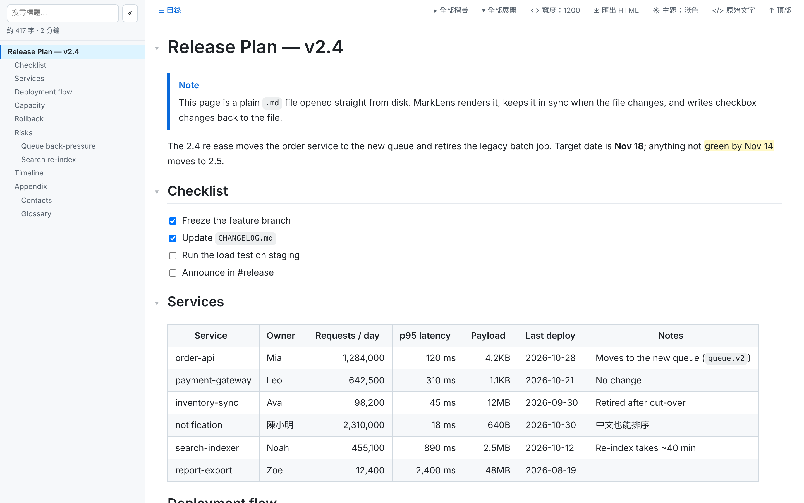
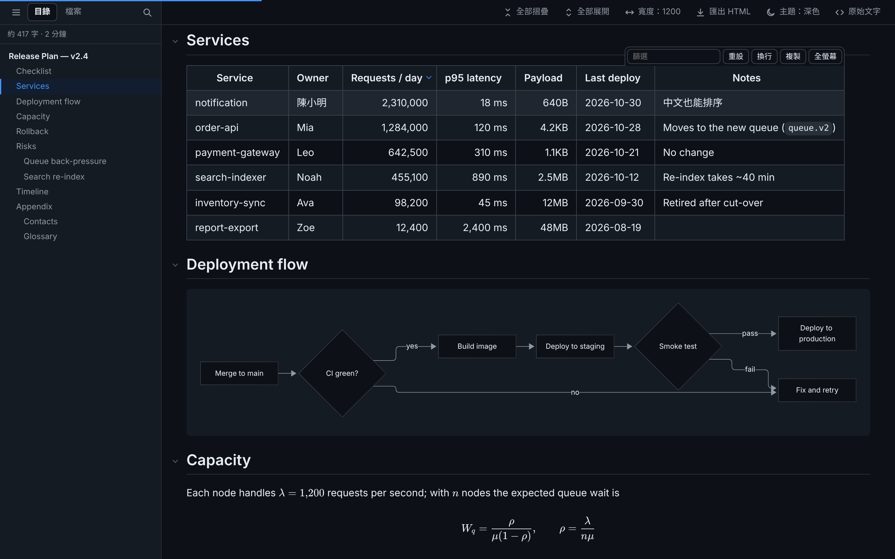

<p align="center">
  
</p>

# MarkLens

[](https://github.com/xjin9612/marklens/actions/workflows/ci.yml)
[](https://github.com/xjin9612/marklens/releases/latest)

[English](./README.md) | 繁體中文

在 Chrome / Edge 直接閱讀 `.md` 檔案的擴充功能，目標是**可稽核、無遠端依賴、無建置流程**。





## 安裝

1. 從[最新 Release](https://github.com/xjin9612/marklens/releases/latest) 下載 `marklens-vX.Y.Z.zip` 並解壓縮（或直接 clone 本 repo）。
2. 開啟 `chrome://extensions`（Edge：`edge://extensions`），打開右上角「開發人員模式」。
3. 點「載入未封裝項目」，選擇解壓縮後的 `marklens-vX.Y.Z` 資料夾（含 `manifest.json` 的資料夾）。
4. 要看本機檔案：在擴充功能「詳細資料」開啟 **「允許存取檔案網址」**。安裝後會自動開啟引導頁帶你完成這一步。

升級時以新版資料夾取代舊的，再到擴充功能頁按重新載入圖示。各版變更見 [CHANGELOG.md](./CHANGELOG.md)。

## 功能

| 類別 | 功能 |
|---|---|
| 頁面 | 接管 `http(s)://` 與 `file://` 下的 `.md` `.markdown` `.mkd` `.mdx`；只在瀏覽器以純文字顯示時接管 |
| 檔案 | 本機檔案：**檔案**分頁列出同資料夾的 Markdown 與子資料夾（資料夾在前、自然排序），子資料夾點開才讀取；↑ 往上一層，資料夾按右鍵「以此資料夾為起點」切回來；略過的名稱可自訂 |
| 工具列 | 頂部固定：側邊欄（☰）、全部摺疊、全部展開、文字寬度（選單）、匯出 HTML、主題（選單：自動／淺色／深色）、原始文字／返回閱讀、回到頂部 |
| 編輯器 | 可選的「編輯」按鈕以 VS Code 開啟本機檔案並跳到目前閱讀的章節，也可用自訂網址範本（`{path}`、`{line}`）對接其他有網址協定的編輯器。記事本、Notepad++ 無法從瀏覽器開啟 |
| 匯出 | 把目前畫面存成單一 HTML 檔（樣式、圖表與公式字型內嵌，段落全部展開，不含 JavaScript），方便分享給沒裝 MarkLens 的人 |
| 版面 | 文字欄寬度：滿版／1600／1200／960／自訂；表格與程式碼可超出文字欄，依內容撐開到版面邊緣；**字體大小等比縮放**整篇文件（內文、標題、程式碼、表格、公式與 Mermaid 圖表），可從工具列或 `+`／`-`／`0` 鍵調整；行高可調；閱讀進度條 |
| 側邊欄 | ☰ 或 `t` 鍵顯示／收合。**目錄**分頁：目前章節高亮、標題搜尋（`/`）、拖拉調整寬度、長標題兩行顯示、標示已摺疊段落、字數與閱讀時間；目錄顯示幾層標題在 popup 設定 |
| 摺疊 | 標題左側 ▾ 摺疊段落；全部摺疊會從第一個有兩個以上標題的層級開始；摺疊內容仍可被 Ctrl+F 搜尋，命中自動展開（約 400KB 以上的大檔為了速度改用一般隱藏，需先展開才搜得到） |
| 表格 | **拖拉欄寬**（雙擊把手自動適應）、**點表頭排序**（數字／千分位／容量單位／日期／中文，空值置底，第三次點擊恢復原順序）、篩選列（5 列以上）、複製為 TSV（可直接貼 Excel）、換行切換、全螢幕（表頭固定）；工具列滑過表格才出現 |
| 語法 | CommonMark + GFM、任務清單、腳註、`==螢光==`、Emoji 短碼（`:tada:`）、GitHub Alert（`> [!NOTE]` 等）、front matter 可收合顯示 |
| 程式碼 | highlight.js 語法高亮（常用語言）、語言標籤、複製、單一區塊換行切換 |
| 圖表 | 本機檔案的 [Mermaid](https://mermaid.js.org/) 流程圖、循序圖等。程式庫約 5MB，只在文件有 mermaid 區塊時才載入；圖表跟隨主題、自動更新時不閃爍，可切回原始碼；語法錯誤會顯示訊息與原始碼。`http(s)://` 頁面不繪製（見安全設計） |
| 數學公式 | 本機檔案的 `$…$`、`$$…$$`、`` $`…`$ `` 與 ` ```math ` 區塊以 [KaTeX](https://katex.org/) 繪製，只在有公式時才載入。`$5 與 $10` 這類金額維持原文。與 Pandoc、GitHub 相同，`$HOME/$USER` 會被當成公式，請放進反引號或寫成 `\$` |
| 圖片 | 延遲載入、點擊放大（Esc 關閉） |
| 主題 | 自動（跟隨系統）／淺色／深色，可從工具列、`d` 鍵或 popup 切換，所有分頁同步 |
| 勾選寫回 | 本機檔案的任務清單直接點勾選框，`[ ]`／`[x]` 立即存回原檔，不必開編輯器。支援巢狀、有序清單與引用區塊；程式碼區塊內的不會被改到。提示列可復原；檔案已被其他地方修改時拒絕寫入；保留 CRLF 與 BOM。需先授權資料夾一次（見下方） |
| 自動更新 | 本機檔案每秒檢查，內容有變才重新渲染；保留捲動位置、摺疊狀態、表格排序／欄寬／篩選 |
| 語言 | 介面支援英文與繁體中文，預設跟隨瀏覽器語言，也可在 popup →「介面語言」指定 |
| 其他 | 外部連結在新分頁開啟（可關閉）、記住每個檔案的閱讀位置、列印樣式、相對路徑 `.md` 連結直接以閱讀器開啟 |

### 勾選寫回

1. 在本機 `.md` 點任一勾選框。第一次會請你授權資料夾：選較上層的資料夾（例如 `D:\Projects`），底下所有 `.md` 都能寫回。
2. 之後點擊即存檔，提示列上按「復原」可還原。
3. Chrome 重新啟動後可能需要再確認一次權限；在 Chrome 的詢問中選「每次造訪時允許」即可免除。

資料夾授權保存在擴充功能自己的空間，一般網頁（包括本機 HTML 檔）無法取得。可從 popup →「管理授權資料夾」查看或移除。

### 分頁獨立與全域設定

- **只影響目前分頁**：側邊欄開關、側邊欄寬度、目前的側邊欄分頁、文字寬度，以及檔案分頁的起點與展開的資料夾。重新整理或在同一分頁開啟其他檔案後保留，關閉分頁即清除；方便多開分頁對照。原始文字模式與摺疊狀態不保留。網頁上的這些狀態只留在記憶體（不寫進網站的儲存空間），重新整理後回到預設值。
- **即時同步所有分頁**：主題、字體大小、行高。
- **popup 其餘設定**：是新分頁的預設值，已開的分頁重新整理後才套用。拖拉側邊欄寬度也會順便記成預設值。

### 快捷鍵

閱讀頁內單鍵（輸入框有焦點時不觸發）：

| 按鍵 | 動作 |
|---|---|
| `t` | 顯示／收合側邊欄 |
| `r` | 原始文字／返回閱讀 |
| `w` | 切換文字寬度 |
| `/` | 搜尋標題（目錄分頁）或檔名（檔案分頁） |
| `d` | 切換主題：自動 → 淺色 → 深色（所有分頁） |
| `[` / `]` | 全部摺疊／全部展開 |
| `+`（或 `=`）／`-`／`0` | 放大／縮小／重設字體大小（所有分頁） |

瀏覽器層級（可在 `chrome://extensions/shortcuts` 修改）：

| 按鍵 | 動作 |
|---|---|
| `Alt+Shift+B` | 顯示／收合側邊欄（目前分頁） |
| `Alt+Shift+C` | 切換文字寬度（目前分頁） |
| `Alt+Shift+R` | 原始文字／返回閱讀（目前分頁） |
| `Alt+Shift+D` | 切換主題（所有分頁） |

## 安全設計

- **HTML 白名單過濾**（`src/content/sanitize.js`）：允許 `<details>`、`<kbd>`、表格等常用標籤；移除 `<script>`、`<iframe>`、`<svg>`、所有事件屬性、`style`（表格對齊除外），以及 `javascript:`、`data:`（圖片除外）等連結。
- **數學公式**：KaTeX 以 `trust: false` 繪製（停用 `\href`、`\url`、`\includegraphics` 與 `\html…` 指令），並限制巨集展開次數；與 Mermaid 相同，程式庫只對 `file://` 頁面開放。
- **不能借用介面**：文件中的 HTML 不能使用 MarkLens 自己的 `ml-` class／id（無法在頁面上蓋出假遮罩或假提示），`name` 屬性只保留給 `<a>`，防止 DOM clobbering。
- **匯出的 HTML** 不含任何 JavaScript，並帶有禁止執行腳本的 CSP，分享出去的檔案無法執行任何程式碼；但文件中的遠端圖片在開啟時仍會載入。
- **攻擊樣本測試**：`test/fixtures/security.md` 收錄 60 多種攻擊寫法，測試會渲染後逐一點擊所有連結與圖表節點，任何程式碼執行即失敗。
- **最小權限**：只要求 `storage`；content script 只在 Markdown 副檔名結尾的網址上執行。不過 Chrome 計算權限時不看網址路徑，因此安裝與詳細資料頁仍會顯示為可存取所有網站。若想限縮，可在擴充功能的詳細資料頁把「網站存取權」改為「在特定網站上」，只加入信任的網站；本機檔案不受影響（由「允許存取檔案網址」控制）。其他網站上的 Markdown 檔就會以純文字顯示。
- **本機檔案讀取**：由 background 代讀，且只允許讀取發出請求的那個頁面本身的網址。
- **資料夾清單**（檔案分頁）同樣由 background 讀取：只接受 `file://` 本機資料夾（不含網路共用、不能有 `.`／`..`），只回傳 Markdown 檔名與子資料夾名稱，不讀檔案內容。
- **寫入**：只在點擊任務勾選框時發生，背景程式確認檔案內容與頁面一致後，只修改那一行。哪些勾選框可寫回由 Markdown 解析器決定，並帶有每次渲染隨機產生的 nonce，文件內嵌的 HTML 無法偽造。
- **Mermaid**：以 `securityLevel: 'strict'` 繪製（標籤經 DOMPurify 過濾、停用點擊事件）。為了能在需要時才載入，程式庫檔案必須設為網頁可存取；存取範圍只開放給 `file://` 頁面，一般網站無法藉由探測這些檔案得知你裝了 MarkLens，這也是只在本機檔案繪製圖表的原因。
- **零遠端資源**：第三方程式庫固定版本放在 `vendor/`，執行時不連網、不自動更新。

## 目錄結構

```
manifest.json
_locales/                介面文字：en（預設）與 zh_TW
src/
  background.js          快捷鍵、代讀本機檔案、資料夾清單、勾選寫回
  shared/settings.js     設定預設值與存取（三端共用）
  shared/i18n.js         介面文字（內容在 _locales/）
  shared/roots.js        已授權資料夾（僅擴充功能內部使用）
  shared/tokens.css      閱讀頁與擴充功能頁面共用的設計變數（色彩、字型、動態）
  shared/theme.js        讓 popup、引導頁、授權頁套用主題設定
  grant/                 資料夾授權頁
  welcome/               首次安裝引導頁
  content/
    early.js             最早執行：換檔時保留舊畫面到新頁排好版、載入中的背景色
    util.js              小工具、讀取原始內容
    icons.js             介面線條圖示（SVG）
    menu.js              下拉選單（工具列寬度／主題、檔案分頁資料夾選單）與鍵盤操作
    fonts.js             程式碼區塊中英字寬對齊
    sanitize.js          HTML 白名單過濾
    markdown.js          markdown-it 設定、==mark==、Alert、front matter
    enhance.js           標題錨點與摺疊、行內內容歸組、任務清單、程式碼區塊、圖片、字數
    mermaid.js           Mermaid 圖表（依需載入）
    math.js              KaTeX 數學公式（依需載入）
    export.js            匯出目前畫面為單一 HTML 檔
    table.js             表格拖拉欄寬、排序、篩選、複製、全螢幕、狀態保存與還原
    toc.js               側邊欄：目錄／檔案分頁、搜尋
    files.js             檔案分頁：資料夾清單、子資料夾依需讀取
    main.js              進入點：版面組裝、工具列、快捷鍵、分頁狀態、自動更新、勾選寫回
    content.css          所有樣式（限定在 html.marklens 底下）
  popup/                 設定面板
vendor/                  第三方程式庫（版本見 VERSIONS.md，授權見 licenses/）
scripts/vendor.mjs       升級 vendor 用的腳本
scripts/release.mjs      發版輔助：版本檢查、取出 Release 說明、打包
scripts/screenshots.mjs  由 docs/demo.md 重新產生 docs/screenshots/（npm run screenshots）
scripts/manual-bigfile.mjs  產生手動測試用的大檔（npm run manual:bigfile）
docs/                    README 截圖與截圖用的示範文件
.github/workflows/       自動測試與自動發布
CHANGELOG.md             版本紀錄（GitHub Release 說明的來源）
test/                    端對端測試（e2e.mjs）、視覺回歸測試（visual.mjs）與測試文件
test/visual/<平台>/       視覺回歸的基準圖，依作業系統分開
test/manual/             手動測試清單
package.json             僅供開發工具使用（測試、更新 vendor），擴充功能本身不需建置
```

### 程式碼區塊中的罫線表格

`┌─┬─┐` 這類文字圖表，要在中文剛好是英數兩倍寬時才會對齊。系統等寬字型（Consolas、Menlo…）沒有中文字，瀏覽器會改用寬度不同的中文字型，於是錯位。MarkLens 會量測實際字寬，只針對中文字元把系統中文字型等比例縮放（`@font-face` 的 `size-adjust`），不必安裝任何字型就能對齊；代價是程式碼中的中文看起來略大。想要最好看的效果，可安裝[更紗黑體（Sarasa Gothic）](https://github.com/be5invis/Sarasa-Gothic)，MarkLens 偵測到 **Sarasa Mono TC** 會自動使用。

完整下載有數百 MB，但只需要其中幾個檔案：

1. 到 [Releases 頁面](https://github.com/be5invis/Sarasa-Gothic/releases)，下載 **Single Family TTF Package → Mono → zip**（選 *Download*；*Unhinted* 適合高解析度螢幕與 macOS）。
2. 解壓縮後只安裝 TC（繁體中文）的檔案：

   | 檔案 | 用途 |
   |---|---|
   | `SarasaMonoTC-Regular.ttf` | 一般文字（必裝） |
   | `SarasaMonoTC-Bold.ttf` | 粗體（必裝） |
   | `SarasaMonoTC-Italic.ttf` | 程式碼註解以斜體顯示；未安裝時瀏覽器會把正體字直接斜推 |
   | `SarasaMonoTC-BoldItalic.ttf` | 可不裝，很少用到 |

3. 選取檔案 → 右鍵 →「為所有使用者安裝」，再完全重啟 Chrome。Chrome 關閉視窗後仍會在背景執行，請在網址列開啟 `chrome://restart`，而不是只關掉視窗。

## 升級第三方程式庫

修改 `scripts/vendor.mjs` 裡的版本表，然後執行：

```bash
npm run vendor
```

## 測試

```bash
npm install                          # 只安裝 playwright（開發用）
npx playwright install chromium      # 第一次需要下載瀏覽器
npm test
```

測試以 Chromium 載入擴充功能，開啟本機與 http 的測試文件（`test/fixtures/sample.md`），涵蓋：

- 渲染：GFM、任務清單（緊湊／鬆散清單）、腳註、Alert、front matter、程式碼高亮、Emoji 短碼、比照 GitHub 的自動連結
- 載入：換檔時保留舊畫面到新頁排好版（沒有空白頁、檔案分頁不出現「讀取中」）、載入中背景沿用上次的主題、停用 MarkLens 時原文照常顯示、非 Markdown 網址不接管
- 安全：script、事件屬性、`javascript:` 連結、style 屬性過濾；以及 `test/fixtures/security.md` 攻擊樣本（危險標籤與網址、編碼繞過、DOM clobbering、偽造介面、檔名、Mermaid）
- 版面：文字欄寬度、寬表格超出文字欄、小表格在各種寬度下不出現捲軸、窄螢幕抽屜側邊欄
- 表格：排序（數字／容量／日期）、拖拉欄寬、篩選、全螢幕與 Esc、自動更新後狀態保留
- 摺疊：全部摺疊／展開、Ctrl+F 命中展開、目錄標記、從目錄或 `#錨點` 網址跳到被摺疊的段落
- 側邊欄：選單鈕位置、`/` 搜尋、檔案分頁（自然排序、略過資料夾、子資料夾依需讀取、切換檔案後起點不變、上一層按鈕、資料夾清單的限制）
- 分頁：側邊欄與寬度只影響目前分頁、外觀設定即時同步、新分頁套用預設值、`Alt+Shift` 快捷鍵、記住閱讀位置
- 連結：外部連結開新分頁（含關閉設定）、編輯器按鈕與網址範本的限制
- 無障礙：每個按鈕都有可念的名稱、鍵盤焦點外框、點擊範圍至少 24×24、用鍵盤排序表格與放大圖片
- 勾選寫回：寫入正確的行（含 front matter）、引用區塊與有序清單、復原、衝突偵測、保留 CRLF 與 BOM、未授權、關閉功能、非 UTF-8 檔案（含手動測試的真實 Big5 文件：照常渲染不出現替代字元，勾選框說明唯讀原因）。資料夾授權以瀏覽器私有檔案系統（OPFS）模擬，資料夾選擇視窗需手動測試
- Mermaid（`test/fixtures/mermaid.md`）：沒有圖表時不載入、繪製、語法錯誤、標籤注入與點擊事件、切換原始碼、主題切換重繪、自動更新不閃爍、http 不繪製、關閉設定
- 數學公式（`test/fixtures/math.md`）：行內、獨立、` ```math `、表格內，金額與跳脫不轉換、語法錯誤、自動更新、http 不繪製、關閉設定
- 匯出：單一檔案不含程式碼、段落展開、樣式與勾選狀態保留、公式字型內嵌
- 介面語言：兩份語系檔鍵值一致、指定介面語言、英文介面冒煙測試
- 安裝後的引導頁、popup 設定、擴充功能重新載入後舊分頁的提示

截圖輸出到 `SHOT_DIR` 環境變數指定的目錄（預設為系統暫存目錄）。

### 視覺回歸測試

```bash
npm run test:visual                  # 與基準圖比對
npm run test:visual -- --update      # 以目前畫面作為新的基準圖
```

把幾個固定畫面（閱讀頁淺色／深色／窄螢幕、檔案分頁、深色 Mermaid、popup、引導頁）截圖，與 `test/visual/<平台>/` 的基準圖逐像素比對。各作業系統字型不同，基準圖依平台分開存放，在新平台第一次執行時建立。不同的像素超過 0.1% 才算失敗（以 `VISUAL_TOLERANCE` 調整），差異圖（不同的像素標紅）輸出到 `SHOT_DIR` 下的 `ml-visual/`。介面有預期中的改動時，先看過差異圖，再加 `--update` 更新基準圖並提交。不在 CI 中執行。

### 手動測試

有些項目無法自動化：資料夾選擇視窗、Chrome 重新啟動後的權限確認、開啟 VS Code，以及字型與圖表的實際顯示效果。`test/manual/` 是發版前在自己的 Chrome 上逐項確認的清單：

1. 第一次先執行 `npm run manual:bigfile`，產生約 1MB 的效能測試檔（不進版控）。
2. 在 `chrome://extensions` 重新載入 MarkLens，開啟 `test/manual/00-說明.md` 依序檢查；用側邊欄的「檔案」分頁切換檔案。
3. 勾選會直接寫回這些檔案，測完執行 `git restore test/manual` 還原。

## 發版流程

1. 在 `CHANGELOG.md` 最上方新增 `## [X.Y.Z] - YYYY-MM-DD` 段落（把 *Unreleased* 的項目移進來）。
2. 將 `manifest.json`（`version` 與 `version_name`）和 `package.json` 改成相同版本。
3. 本機檢查：`node scripts/release.mjs check vX.Y.Z`
4. commit 後執行 `git tag vX.Y.Z`、`git push origin main --tags`。

**Release** workflow 會確認標籤、`manifest.json`、`package.json`、`CHANGELOG.md` 版本一致，跑測試，打包只含擴充功能檔案的 `marklens-vX.Y.Z.zip`，並以該版 CHANGELOG 段落為說明發布 GitHub Release。每次 push 到 `main` 與每個 pull request 都會由 **Tests** workflow 自動跑測試。

## 開發計畫

- 上架 Chrome 線上應用程式商店／Edge 附加元件
- 更多介面語言

## 授權

MIT。第三方程式庫各自的授權見 `vendor/licenses/`（Mermaid 的打包檔另含 D3、DOMPurify 等相依套件，依其各自授權）。
