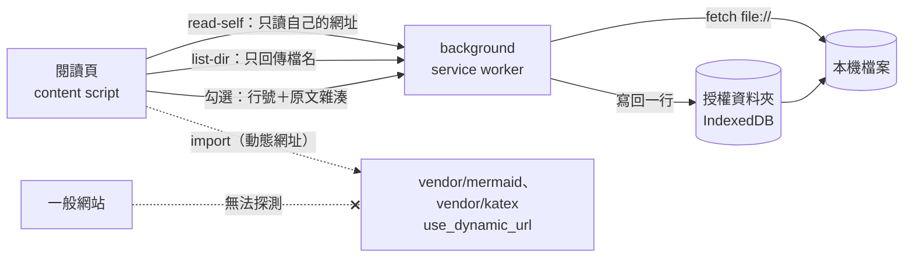

# Markloupe 開發文件

給參與開發的人。使用說明見 [README](../README.md)。

擴充功能不需要建置：`src/` 與 `vendor/` 就是瀏覽器載入的檔案。`package.json` 只供開發工具使用。

## 開發環境

### Linux／WSL

```bash
sh scripts/setup-linux.sh
```

腳本安裝 npm 套件、Playwright Chromium 與系統套件、`fonts-noto-cjk`、`poppler-utils`、`ffmpeg`，可以重複執行。字型與 CI 相同。

Playwright 可能提示放寬 Chromium 沙箱的系統設定，不需要照做。Playwright 在 Linux 預設不使用 Chromium 沙箱，測試也只開啟 repo 內的檔案與本機伺服器。

### Windows

```bash
npm ci
npx playwright install chromium
```

Windows 上的 `npm test` 跳過「檔名中的 HTML 不會被執行」。這項要建立檔名含 `<`、`>` 的檔案，Windows 不允許這種檔名。CI 在 Linux 上執行這一項。

### macOS

```bash
npm ci
npx playwright install chromium
```

macOS 的 Chromium 不理會 `--lang`，介面語言取自 `AppleLanguages` 偏好設定。`npm test` 啟動瀏覽器前，會以 `defaults` 寫入測試用 Chromium 的偏好設定，結束時刪除，不動系統設定。

### 載入擴充功能

1. 開啟 `chrome://extensions`，打開「開發人員模式」。
2. 按「載入未封裝項目」，選擇 repo 根目錄。
3. 改了程式後按重新載入圖示，**再重新整理已開的 `.md` 分頁**。

## 目錄結構

```
manifest.json
_locales/                介面文字：en（預設）、zh_TW、zh_CN（由 zh_TW 以 OpenCC tw2sp 轉換後人工校對）
src/
  background.js          快捷鍵、代讀本機檔案、資料夾清單、勾選寫回
  shared/settings.js     設定預設值與存取（三端共用）
  shared/palette.js      自訂配色：由底色、文字色、強調色推算其餘設計變數（閱讀頁與 popup 共用）
  shared/i18n.js         介面文字（內容在 _locales/）
  shared/roots.js        已授權資料夾（僅擴充功能內部使用）
  shared/hash.js         原文的 SHA-256（閱讀頁與 background 共用，勾選寫回時比對）
  shared/lines.js        原文切行（閱讀頁與 background 共用，行號與 markdown-it 一致）
  shared/web-access.js   網頁上 .md 的選用網站權限（popup、引導頁、background 共用）
  shared/tokens.css      閱讀頁與擴充功能頁面共用的設計變數（色彩、字型、動態）
  shared/theme.js        讓 popup、引導頁、授權頁套用主題設定
  grant/                 資料夾授權頁
  welcome/               首次安裝引導頁
  content/
    early.js             最早執行：換檔時保留舊畫面到新頁排好版、載入中的背景色
    util.js              小工具、讀取原始內容
    icons.js             介面線條圖示（SVG）
    menu.js              下拉選單（工具列寬度／主題／字級、檔案分頁資料夾選單）與鍵盤操作
    fonts.js             程式碼區塊中英字寬對齊
    sanitize.js          HTML 白名單過濾
    markdown.js          markdown-it 設定、==mark==、Alert、front matter、數學公式標記
    enhance.js           標題錨點與摺疊、行內內容歸組、任務清單、程式碼區塊、圖片、字數
    mermaid.js           Mermaid 圖表（依需載入）
    math.js              KaTeX 數學公式（依需載入）
    export.js            匯出目前畫面為單一 HTML 檔
    table.js             表格拖拉欄寬、排序、篩選、複製、全螢幕、狀態保存與還原
    toc.js               側邊欄：目錄／檔案分頁、搜尋、目前章節高亮
    files.js             檔案分頁：資料夾清單、子資料夾依需讀取
    source.js            渲染結果對應回原文：區塊與章節的行號範圍、位置文字（複製位置、複製原文）
    main.js              進入點：版面組裝、工具列、快捷鍵、分頁狀態、自動更新、勾選寫回、列印
    content.css          所有樣式（限定在 html.markloupe 底下）
  popup/                 設定面板
vendor/                  第三方程式庫（版本見 VERSIONS.md，授權見 licenses/）
scripts/
  setup-linux.sh         Linux／WSL 開發環境安裝
  vendor.mjs             升級 vendor
  release.mjs            發版輔助：版本與商店欄位長度檢查、取出 Release 說明、打包
  screenshots.mjs        README 與商店截圖（npm run screenshots）
  demo-gifs.mjs          README 的示範動畫（npm run gifs）
  layout-audit.mjs       版面檢查（npm run audit:layout）
  manual-bigfile.mjs     產生手動測試用的大檔（npm run manual:bigfile）
docs/
  DEVELOPMENT.md         本文件
  demo.md、demo.zh-TW.md 截圖用的示範文件
  screenshots/           README 用的示範動畫（*.gif）與截圖（<語系>/）
  store/                 商店截圖、宣傳圖、示範表格與送審資料（listing.md）
.github/workflows/       自動測試（ci.yml）、自動發布（release.yml）、Linux 視覺基準圖（visual-baselines.yml）
.github/dependabot.yml   每月更新 Actions 與 npm 開發套件
test/
  e2e.mjs                端對端測試
  visual.mjs             視覺回歸測試
  fixtures/              測試文件（含 security.md 攻擊樣本）
  visual/<平台>/          視覺回歸的基準圖，依作業系統分開
  manual/                手動測試清單
CHANGELOG.md             版本紀錄（英文，GitHub Release 說明的來源）
PRIVACY.md、PRIVACY.zh-TW.md  隱私權政策（商店送審使用）
```

## 安全設計

Markloupe 不收集任何資料。唯一主動的網路請求，是重新載入使用者開啟的文件（[隱私權政策](../PRIVACY.zh-TW.md)）。



- **HTML 白名單**（`src/content/sanitize.js`）：保留 `<details>`、`<kbd>`、表格等常用標籤。移除 `<script>`、`<iframe>`、`<svg>`、事件屬性與 `style`（表格對齊除外）。也移除 `javascript:` 與非圖片的 `data:` 連結。
- **不能借用介面**：文件中的 HTML 不能使用 `ml-` 開頭的 class 與 id，無法蓋出假的提示。`name` 屬性只保留給 `<a>`，防止 DOM clobbering。
- **數學公式**：KaTeX 以 `trust: false` 繪製，停用 `\href`、`\url`、`\includegraphics` 與 `\html…`。巨集展開次數有上限。
- **Mermaid**：以 `securityLevel: 'strict'` 繪製。標籤經 DOMPurify 過濾，點擊事件停用。`htmlLabels: false` 讓標籤畫成 SVG 文字，圖表裡沒有 `foreignObject` 與任何 HTML 元素。
- **程式庫不讓網站探測**：Mermaid 與 KaTeX 用到時才載入，所以列為 web accessible resources。
  - 兩者都開放給所有網頁，但設 `use_dynamic_url`，網址每個工作階段都不同，網站無法以固定的擴充功能 ID 探測。
  - 動態網址下，模組內的相對路徑 import 會被解析成固定 ID 的網址而被擋，所以程式庫必須是單一檔案。Mermaid 官方的 ESM 版拆成多個 chunk，`scripts/vendor.mjs` 改取單檔版，把結尾掛上 `globalThis` 的那一行改成 `export default`。
  - KaTeX 樣式表裡字型的相對路徑會被解析成固定 ID 的網址而被擋，`math.js` 讀取樣式表後改寫成動態網址，再以 constructable stylesheet 套用。
- **匯出的 HTML**：不含 JavaScript，並以 CSP 禁止執行腳本。選「圖片保留連結」時，遠端圖片在開啟時仍會載入。
- **單一檔不帶出本機路徑**：指向本機檔案的網址保留原文的寫法，內嵌失敗的圖片也一樣，匯出器不產生 `file:` 網址。原文自己寫的 `file:` 網址照原文保留。sanitizer 不允許 `srcset`；開放時要一併改寫。
- **內嵌圖片**：選「單一檔」時，由背景程式讀取圖片，依檔頭確認是圖片才內嵌，單張上限 10 MB，讀取中超過上限就中斷。匯出檔可能被分享出去，所以網路上的文件不能內嵌 `file://` 圖片，也不能內嵌內網與本機服務的圖片（`localhost`、`.local`、沒有點號的主機名稱、私有 IP），與文件同源的除外；重新導向後的網址也要符合。以一般網域名稱指向內網的主機判斷不到。
- **最小權限**：安裝時只要求 `storage` 與 `scripting`，manifest 的 content script 只處理本機檔案，安裝時沒有網站權限警告。
  - 網頁上的 `.md` 是選用的 `optional_host_permissions`（`*://*/*`）。使用者在 popup 或引導頁開啟後，background 以 manifest 中同樣的兩組腳本註冊到網頁網址（`syncWebScripts`），撤銷權限時移除。
  - 腳本只比對 Markdown 副檔名結尾的網址。Chrome 的主機權限不能限制路徑，所以權限對話框仍顯示為所有網站。
- **讀取本機檔案**：background 只讀取發出請求的頁面自己的網址。
- **不載入其他電腦的檔案**：文件中指向其他主機的 `file://` 網址（`file://主機/…`、`file:////主機/…`）會被移除，不會載入網路共用上的檔案。
- **資料夾清單**：background 只接受 `file://` 本機資料夾，不含網路共用與 `.`、`..`。只回傳 Markdown 檔名與子資料夾名稱，不讀內容。
- **寫入**：只在點擊任務勾選框時發生。授權資料夾只以名稱對應到網址路徑，background 先比對授權資料夾中的檔案與頁面所在的檔案內容相同，再確認原文雜湊一致，才修改那一行。行號只接受非負整數，勾選狀態只接受空白與 `x`。可寫回的勾選框由 Markdown 解析器標記，並帶有每次渲染隨機產生的 nonce，文件內的 HTML 無法偽造。
- **授權資料夾**：存在擴充功能自己的 IndexedDB，一般網頁與本機 HTML 檔都取不到。
- **設定同步**：只同步 `settings.js` 的 `SYNC_KEYS` 與自訂 CSS，由瀏覽器帳號處理。授權資料夾、閱讀位置、編輯器網址不同步。
- **舊名稱的資料**：更新時，background 把舊名稱 MarkLens 的儲存鍵（`marklens:`）與資料庫（`marklens`）搬到新名稱。頁面的 `localStorage` 與 `sessionStorage` 只存主題快取、分頁狀態與 popup 區塊的展開狀態，不搬移。
- **自訂 CSS**：寫進匯出檔時跳脫 `</style`，不能跳出樣式區塊。
- **列印**：以 `@page` 頁邊方塊取代 Chrome 的頁首頁尾，PDF 不含本機檔案路徑。
- **沒有遠端程式碼**：第三方程式庫固定版本放在 `vendor/`，執行時不下載、不更新。
- **攻擊樣本**：`test/fixtures/security.md` 收錄 60 多種攻擊寫法。測試渲染後逐一點擊連結與圖表節點，任何程式碼執行就失敗。

## 程式碼區塊中的框線字元對齊

`┌─┬─┐` 這類文字圖表，要中文剛好兩個英數字寬才會對齊。系統等寬字型沒有中文字，瀏覽器會改用寬度不同的中文字型。`fonts.js` 量測實際字寬，只把中日韓字元的系統字型等比縮放（`@font-face` 的 `size-adjust`）。偵測到更紗黑體（Sarasa Mono TC 或 SC）時直接使用它。

## 升級第三方程式庫

版本記在 `scripts/vendor/package.json`，integrity（套件檔的 sha512）記在同一資料夾的 `package-lock.json`。這兩個檔案只用來記錄版本與讓 GitHub 發出漏洞警示，不會安裝套件。

1. 修改 `scripts/vendor/package.json` 的版本。
2. 在 `scripts/vendor/` 執行 `npm install --package-lock-only --ignore-scripts`，更新 lockfile。
3. 在 repo 根目錄執行 `npm run vendor`。檔案寫進 `vendor/`，版本表寫進 `vendor/VERSIONS.md`，授權檔寫進 `vendor/licenses/`。

- 下載的套件檔與 lockfile 的 integrity 不符就中止。
- 版本發布未滿 7 天就中止，避開剛發布就被撤下的惡意版本。
- 安全性修補要立刻升級時，在 `vendor.mjs` 的 `PACKAGES` 該套件加上 `minAgeDays: 0` 並註明原因。滿 7 天後拿掉。
- 有漏洞時 Dependabot 會發警示，並開 PR 更新這兩個檔案。PR 不會重新產生 `vendor/`，CI 的 `vendor` job 會失敗；在該分支執行第 3 步再提交。

## 供應鏈

| 檢查 | 位置 | 內容 |
|---|---|---|
| 重現 vendor | `ci.yml` 的 `vendor` job | 重新執行 `vendor.mjs`：套件檔要符合 lockfile 的 integrity，`vendor/` 有任何差異就失敗 |
| 漏洞警示 | `scripts/vendor/package-lock.json` | Dependabot alerts 依 lockfile 檢查 `vendor/` 的程式庫 |
| 套件簽章 | `ci.yml` 的 `e2e` job | `npm audit signatures` 驗證開發套件的 registry 簽章 |
| Actions 釘選 | 所有 workflow | 以 commit SHA 引用，註解標示版本 |
| 自動更新 | `.github/dependabot.yml` | 每月為 Actions 與 npm 開 PR，新版滿 7 天才提議 |
| 建置來源證明 | `release.yml` | Release 的 zip 附 GitHub 的 build provenance |
| 不執行安裝腳本 | `.npmrc` | `ignore-scripts=true`：`npm ci` 不執行套件的 install 腳本 |

- 重現 vendor 證明 repo 中的檔案等於 npm 上的官方套件，加上 `vendor.mjs` 寫明的轉換。`npm pack` 下載時會比對 registry 的雜湊。
- `vendor/` 的程式庫不在 `dependabot.yml`，不會收到每月的版本更新 PR；只有出現漏洞時才有警示與安全性更新 PR。
- 驗證 Release 的 zip：
  ```bash
  gh attestation verify markloupe-vX.Y.Z-store.zip --repo xjin9612/markloupe
  ```

## 測試

### 端對端測試

```bash
npm test
```

以 Chromium 載入擴充功能，開啟本機與 http 的測試文件。push 到 `main` 與 pull request 時由 CI 在 Linux、macOS、Windows 上執行。截圖輸出到 `SHOT_DIR`，預設為系統暫存目錄。涵蓋：

- 渲染：GFM、任務清單（緊湊／鬆散清單）、腳註（滑過或聚焦上標時預覽，Esc 收起）、Alert、front matter（單層 key: value 以鍵值清單顯示，巢狀時顯示原文）、程式碼高亮、Emoji 短碼、比照 GitHub 的自動連結
- 載入：換檔時保留舊畫面到新頁排好版、載入中背景沿用上次的主題、停用 Markloupe 時原文照常顯示、非 Markdown 網址不接管
- 安全：script、事件屬性、`javascript:` 連結、style 屬性過濾；`test/fixtures/security.md` 攻擊樣本（危險標籤與網址、編碼繞過、DOM clobbering、偽造介面、檔名、Mermaid）
- 版面：文字欄寬度、寬表格超出文字欄、小表格在各種寬度下不出現捲軸、窄螢幕抽屜側邊欄、寬視窗下數學公式與 Mermaid 錯誤訊息對齊文字欄、回到頂部按鈕出現時其他按鈕不位移
- 表格：排序（數字／容量／日期）、拖拉欄寬、篩選、全螢幕與 Esc、自動更新後狀態保留、複製選單（TSV、沿用原文列的 Markdown、CSV 的 BOM 與公式防護，都套用篩選）
- 摺疊：全部摺疊／展開、Ctrl+F 命中展開、目錄標記、從目錄或 `#錨點` 網址跳到被摺疊的段落、`n`／`p` 跳到上下一個標題時略過被摺疊的標題
- 側邊欄：選單鈕位置、`/` 搜尋、目錄高亮（含頁尾的短章節）、專注模式（f 與寬度選單、重新整理後保留）、各章節的任務完成數（含子章節、勾選後更新）、檔案分頁（自然排序、略過資料夾、子資料夾依需讀取、切換檔案後起點不變、上一層按鈕、資料夾清單的限制）
- 分頁：側邊欄與寬度只影響目前分頁、外觀設定即時同步、新分頁套用預設值、`Alt+Shift` 快捷鍵、記住閱讀位置
- 外觀：配色（含 Mermaid 依配色重繪，每組配色的文字、連結、語法標示與提示框標題至少 4.5:1）、自訂配色（推算的顏色至少 4.5:1、不合法的色碼改用預設值、改色時重繪 Mermaid、匯出檔帶上、popup 的色碼欄位與調色區塊：預覽不存檔、完成才存檔、取消或關閉 popup 還原）、自訂 CSS（含匯出檔不能被提前結束 `<style>`）
- 設定同步：寫入與套用 `storage.sync`、關閉後停止、裝置專屬設定不同步；匯出與匯入 JSON（直接在 popup 選檔、不合法的值略過；macOS 全螢幕時改在分頁）
- 舊名稱搬移：`marklens:` 開頭的儲存鍵與 `marklens` 資料庫搬到新名稱，新鍵已有值時保留
- 連結：外部連結開新分頁（含關閉設定）、編輯器按鈕與網址範本的限制
- 無障礙：每個按鈕都有可念的名稱、鍵盤焦點外框、點擊範圍至少 24×24、用鍵盤排序表格與放大圖片
- 勾選寫回：寫入正確的行（含 front matter、單獨的 `\r` 換行）、引用區塊與有序清單、復原、衝突偵測、保留 CRLF 與 BOM、未授權、只授權了別處的同名檔案、關閉功能、非 UTF-8 檔案（含手動測試的真實 Big5 文件）。資料夾授權以瀏覽器私有檔案系統（OPFS）模擬，資料夾選擇視窗需手動測試
- 複製：工具列與章節的選單、附 HTML 格式、位置的路徑與行號、引用中的標題與章節範圍、選取文字（含從任務勾選框開始的選取）、原始文字的行號
- 網站權限：manifest 只固定注入本機檔案、安裝時沒有權限警告、授予後註冊的腳本與 manifest 相同、popup 開關反映權限。Chrome 的權限對話框無法自動化，測試載入一份把網站權限改成安裝時授予的副本
- Mermaid（`test/fixtures/mermaid.md`）：沒有圖表時不載入、繪製、語法錯誤、標籤注入與點擊事件、切換原始碼、全螢幕縮放與平移、主題切換重繪、自動更新不閃爍、http 不繪製並說明原因、關閉設定
- 數學公式（`test/fixtures/math.md`）：行內、獨立、` ```math `、表格內，金額與跳脫不轉換、語法錯誤、點公式複製 LaTeX（選取文字時不複製）、自動更新、http 不繪製並說明原因、關閉設定
- 匯出與列印：單一檔案不含程式碼、段落展開、樣式與勾選狀態保留、公式字型內嵌，內嵌本機與網路圖片、讀不到或不是圖片的維持原網址、單一檔的本機連結保留相對路徑並改成 .html、front matter 的 lang、網路上的文件不內嵌本機與內網圖片、超過大小上限與連不上的回報；列印樣式展開摺疊、深色主題改用淺色、圖表以淺色重繪後還原
- 介面語言：兩份語系檔鍵值一致、指定介面語言、英文介面冒煙測試
- 安裝後的引導頁、popup 設定、擴充功能重新載入後舊分頁的提示

### 視覺回歸測試

```bash
npm run test:visual                  # 與基準圖比對
npm run test:visual -- --update      # 以目前畫面作為新的基準圖
```

比對幾個固定畫面的截圖與 `test/visual/<平台>/` 的基準圖：閱讀頁淺色、深色、窄螢幕、檔案分頁、深色 Mermaid、popup、引導頁。

- 字型隨作業系統不同，基準圖依平台分開。`win32` 在 Windows 上建立。macOS 沒有基準圖，第一次執行時以當下畫面建立。
- `linux` 由 GitHub Actions 的 **Visual baselines** workflow 產生，環境與 CI 相同（固定 `ubuntu-26.04`；升級作業系統時要重新產生）。下載 artifact，覆蓋 `test/visual/linux/` 再提交。
  - PR 改到畫面相關的檔案時自動執行。
  - 手動觸發要等 workflow 檔已在 main 上，這是 GitHub 對 `workflow_dispatch` 的限制。
  ```bash
  gh workflow run visual-baselines.yml --ref <分支>   # 手動觸發；開 PR 時不需要
  rm test/visual/linux/*.png   # gh run download 不覆寫已存在的檔案
  gh run download --name visual-linux --dir test/visual/linux
  ```
- 不同的像素超過 0.1% 才算失敗，以 `VISUAL_TOLERANCE` 調整。
- 差異圖輸出到 `SHOT_DIR` 下的 `ml-visual/`，不同的像素標紅。
- 介面有預期的改動時，先看差異圖，再加 `--update` 更新兩個平台的基準圖。
- 不在 CI 中執行。

### 版面檢查

```bash
npm run audit:layout
```

以 1920、1280、900、420 四種寬度與中英介面，開啟 repo 內所有 Markdown 文件。檢查項目：

- 整頁橫向溢出
- 一般內容沒對齊文字欄
- 工具列換行或溢出
- 內容溢出容器

表格與程式碼可以超出文字欄，只列出供參考。改了 `content.css`、工具列或側邊欄後執行，有問題時結束碼為 1。不在 CI 中執行。

### 列印

`emulateMedia({ media: 'print' })` 重現不了部分列印問題，例如表格框線。確認列印結果時，用 `page.pdf()` 輸出 PDF；`displayHeaderFooter: true` 可模擬列印對話框的頁首頁尾。再以 `pdftoppm` 轉成圖片，或以 `pdftotext` 取出文字檢查。

### 手動測試

`test/manual/` 是發版前在 Chrome 上逐項確認的清單。涵蓋無法自動化的項目：資料夾選擇視窗、重新啟動後的權限確認、開啟 VS Code、列印對話框、字型與圖表的實際顯示。

1. 第一次先執行 `npm run manual:bigfile`，產生約 1MB 的效能測試檔，不進版控。
2. 在 `chrome://extensions` 重新載入 Markloupe，開啟 `test/manual/00-說明.md` 依序檢查。用側邊欄的「檔案」分頁切換檔案。
3. 勾選會寫回這些檔案，測完執行 `git restore test/manual`。

## 截圖與示範動畫

### 截圖

```bash
npm run screenshots
```

以 `docs/demo.md`（英文）與 `docs/demo.zh-TW.md`（繁中）產生：

- `docs/screenshots/<語系>/`：README 用的截圖
- `docs/store/<語系>/`：商店截圖、440×280 小型宣傳圖、1400×560 大型宣傳圖

請在 Windows 上執行，畫面才會用 Segoe UI 與微軟正黑體。說明文字與宣傳圖標語在 `scripts/screenshots.mjs` 的 `LANGS`。

### 示範動畫

```bash
CDP_URL=http://127.0.0.1:9222 npm run gifs
```

產生 README 的 `docs/screenshots/*.gif`，介面一律英文。腳本連到一個開著遠端除錯埠的 Chrome，以 CDP 錄製畫面，再用 `ffmpeg` 轉成 GIF。這個 Chrome 要先載入 Markloupe，並開啟「允許存取檔案網址」。

腳本會改動該 Chrome 的 Markloupe 設定，結束時還原；也會加入一個授權資料夾。請用專用的 profile，例如：

```powershell
chrome.exe --remote-debugging-port=9222 --user-data-dir="$env:TEMP\markloupe-cdp"
```

只錄一段時把名稱放在最後，例如 `npm run gifs -- tables`。

## 發版流程

1. 在 `CHANGELOG.md` 最上方新增 `## [X.Y.Z] - YYYY-MM-DD` 段落，把 *Unreleased* 的項目移進來。CHANGELOG 以英文撰寫，寫給使用者看。
2. 把 `manifest.json` 的 `version`、`version_name` 與 `package.json` 改成相同版本。
3. 本機檢查：`node scripts/release.mjs check vX.Y.Z`。CI 也會以 `package.json` 的版本執行這項檢查。
4. commit 後執行 `git tag vX.Y.Z`、`git push origin main --tags`。

**Release** workflow 依序執行：

1. 確認標籤、`manifest.json`、`package.json`、`CHANGELOG.md` 的版本一致。
2. 確認名稱與說明符合商店的長度上限。
3. 跑測試，打包擴充功能的檔案。
4. 為兩個 zip 產生建置來源證明。
5. 以該版 CHANGELOG 段落為說明，發布 GitHub Release，附兩個 zip：
   - `markloupe-vX.Y.Z.zip`：內含 `markloupe-vX.Y.Z/` 資料夾，供「載入未封裝項目」使用
   - `markloupe-vX.Y.Z-store.zip`：`manifest.json` 位於根目錄，上傳 Chrome Web Store 與 Edge Add-ons 用

商店後台要填的文字與圖片見 [docs/store/listing.md](store/listing.md)。
