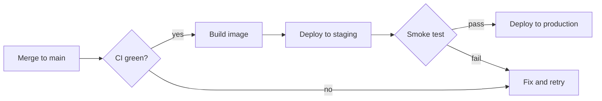

# Release Plan — v2.4

> [!NOTE]
> This page is a plain `.md` file opened straight from disk. Markloupe renders it, keeps it in sync when the file changes, and writes checkbox changes back to the file.

The 2.4 release moves the order service to the new queue and retires the legacy batch job. Target date is **Nov 18**; anything not ==green by Nov 14== moves to 2.5.

## Checklist

- [x] Freeze the feature branch
- [x] Update `CHANGELOG.md`
- [ ] Run the load test on staging
- [ ] Announce in #release

## Services

| Service | Owner | Requests / day | p95 latency | Payload | Last deploy | Notes |
|---|---|---:|---:|---:|---|---|
| order-api | Mia | 1,284,000 | 120 ms | 4.2KB | 2026-10-28 | Moves to the new queue (`queue.v2`) |
| payment-gateway | Leo | 642,500 | 310 ms | 1.1KB | 2026-10-21 | No change |
| inventory-sync | Ava | 98,200 | 45 ms | 12MB | 2026-09-30 | Retired after cut-over |
| notification | 陳小明 | 2,310,000 | 18 ms | 640B | 2026-10-30 | 中文也能排序 |
| search-indexer | Noah | 455,100 | 890 ms | 2.5MB | 2026-10-12 | Re-index takes ~40 min |
| report-export | Zoe | 12,400 | 2,400 ms | 48MB | 2026-08-19 | |

## Deployment flow



## Capacity

Each node handles $\lambda = 1{,}200$ requests per second; with $n$ nodes the expected queue wait is

$$
W_q = \frac{\rho}{\mu (1 - \rho)}, \qquad \rho = \frac{\lambda}{n \mu}
$$

## Rollback

```bash
# Roll back one service to the previous image
kubectl rollout undo deployment/order-api -n prod
kubectl rollout status deployment/order-api -n prod --timeout=120s
```

```text
┌──────────────┬──────────┬──────────┐
│ 環境         │ 版本     │ 狀態     │
├──────────────┼──────────┼──────────┤
│ staging      │ 2.4.0    │ 通過     │
│ production   │ 2.3.7    │ 待部署   │
└──────────────┴──────────┴──────────┘
```

## Risks

### Queue back-pressure

If the new queue lags, order-api falls back to synchronous writes. Watch the `queue_lag_seconds` dashboard during the first hour.

### Search re-index

The re-index runs after deploy and takes about 40 minutes; search results may be stale in the meantime.

## Timeline

| Date | Milestone |
|---|---|
| Nov 10 | Code freeze |
| Nov 14 | Go / no-go |
| Nov 18 | Production deploy |

## Appendix

### Contacts

On-call rotation is in the team calendar.

### Glossary

**Cut-over** — the moment traffic switches from the old path to the new one.
