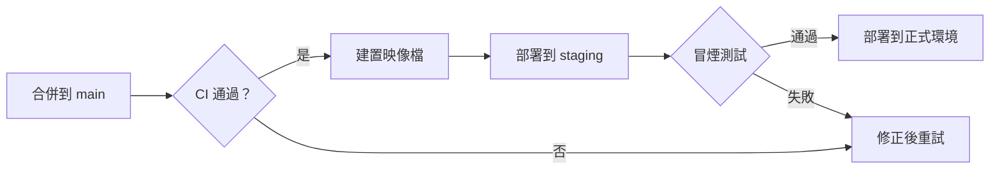

# 發版計畫 — v2.4

> [!NOTE]
> 這一頁是直接從硬碟開啟的一般 `.md` 檔案。MarkLens 負責顯示，檔案變動時自動同步，勾選任務也會寫回檔案。

2.4 版會把訂單服務搬到新的佇列，並停用舊的批次作業。預計 **11 月 18 日**上線；==11 月 14 日前還沒全綠==的項目延到 2.5。

## 檢查清單

- [x] 凍結功能分支
- [x] 更新 `CHANGELOG.md`
- [ ] 在 staging 跑壓力測試
- [ ] 在 #release 頻道公告

## 服務

| 服務 | 負責人 | 每日請求數 | p95 延遲 | 資料量 | 上次部署 | 備註 |
|---|---|---:|---:|---:|---|---|
| order-api | 林雅婷 | 1,284,000 | 120 ms | 4.2KB | 2026-10-28 | 改用新佇列（`queue.v2`） |
| payment-gateway | 王建宏 | 642,500 | 310 ms | 1.1KB | 2026-10-21 | 無變更 |
| inventory-sync | 張怡君 | 98,200 | 45 ms | 12MB | 2026-09-30 | 切換後停用 |
| notification | 陳小明 | 2,310,000 | 18 ms | 640B | 2026-10-30 | 依筆畫排序也正確 |
| search-indexer | 李志豪 | 455,100 | 890 ms | 2.5MB | 2026-10-12 | 重建索引約 40 分鐘 |
| report-export | 吳佩珊 | 12,400 | 2,400 ms | 48MB | 2026-08-19 | |

## 部署流程



## 容量

每個節點每秒可處理 $\lambda = 1{,}200$ 個請求；有 $n$ 個節點時，預期的排隊等待時間為

$$
W_q = \frac{\rho}{\mu (1 - \rho)}, \qquad \rho = \frac{\lambda}{n \mu}
$$

## 回復

```bash
# 把單一服務回復到上一版映像檔
kubectl rollout undo deployment/order-api -n prod
kubectl rollout status deployment/order-api -n prod --timeout=120s
```

```text
┌──────────────┬──────────┬──────────┐
│ 環境         │ 版本     │ 狀態     │
├──────────────┼──────────┼──────────┤
│ staging      │ 2.4.0    │ 通過     │
│ production   │ 2.3.7    │ 待部署   │
└──────────────┴──────────┴──────────┘
```

## 風險

### 佇列積壓

新佇列延遲時，order-api 會改回同步寫入。上線後第一個小時請盯著 `queue_lag_seconds` 儀表板。

### 重建搜尋索引

部署後會重建索引，約需 40 分鐘，期間搜尋結果可能不是最新的。

## 時程

| 日期 | 里程碑 |
|---|---|
| 11 月 10 日 | 程式碼凍結 |
| 11 月 14 日 | 確認是否上線 |
| 11 月 18 日 | 正式部署 |

## 附錄

### 聯絡人

值班輪替表在團隊行事曆上。

### 名詞解釋

**切換（Cut-over）** — 流量從舊路徑轉到新路徑的那一刻。
