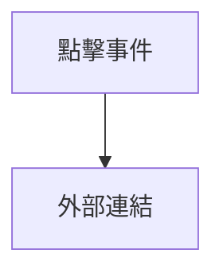
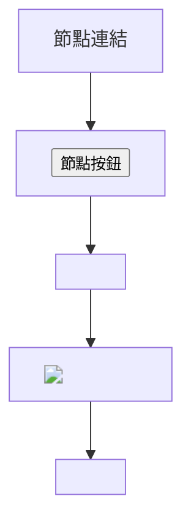
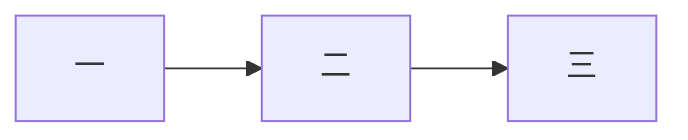
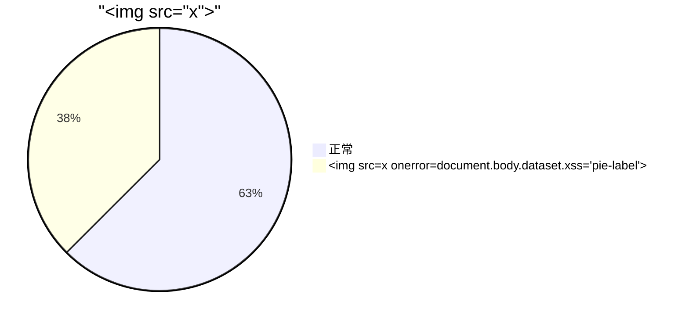
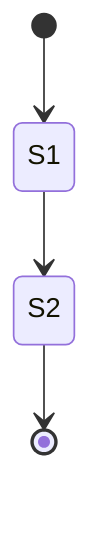
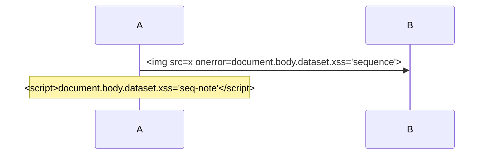
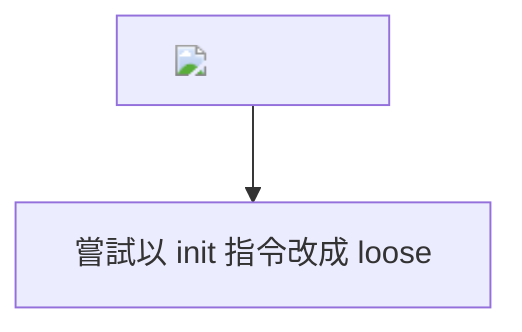

# 安全性測試

每個攻擊成功時都會在 `<body>` 留下 `data-xss` 標記或跳出對話框；測試預期兩者都不會發生。
部分案例改寫自 local-markdown-viewer 的 security-tests.md（MIT, © 2025 mutsuya117）。

## 1. script 標籤

## 2. 事件屬性

點我不應有反應

滑過不應有反應

<body onload="document.body.dataset.xss='body-onload'">
<input autofocus onfocus="document.body.dataset.xss='onfocus'">
<button onclick="document.body.dataset.xss='button'">按鈕</button>

details
內容

<marquee onstart="document.body.dataset.xss='marquee'">marquee</marquee>
<video src="x" onerror="document.body.dataset.xss='video-onerror'"></video>
<audio src="x" onerror="document.body.dataset.xss='audio-onerror'"></audio>

## 3. javascript: 與其他危險 scheme

[markdown 連結](javascript:document.body.dataset.xss='md-link')

<a href="javascript:document.body.dataset.xss='a-href'" class="evil-link">HTML 連結</a>
<a href=" JaVaScRiPt:document.body.dataset.xss='a-mixed-case'" class="evil-link">大小寫混合</a>
<a href="&#106;avascript:document.body.dataset.xss='a-entity'" class="evil-link">實體編碼</a>
<a href="java&#x09;script:document.body.dataset.xss='a-tab'" class="evil-link">夾 Tab</a>
<a href="java&#x0A;script:document.body.dataset.xss='a-newline'" class="evil-link">夾換行</a>
<a href="vbscript:msgbox(1)" class="evil-link">vbscript</a>
<a href="javascript:void(0)" onclick="document.body.dataset.xss='a-onclick'" class="evil-link">void + onclick</a>

## 4. data: scheme

document.body.dataset.xss='data-img'</script>">

<a href="data:text/html," class="evil-link">data 連結</a>

## 5. 內嵌框架與外掛

<iframe src="javascript:document.body.dataset.xss='iframe'"></iframe>
<iframe srcdoc=""></iframe>
<object data="javascript:document.body.dataset.xss='object'"></object>
<embed src="javascript:document.body.dataset.xss='embed'">
<frameset><frame src="javascript:alert(1)"></frameset>

## 6. style

不應覆蓋整頁

行內 style

## 7. SVG 與 MathML

<svg onload="document.body.dataset.xss='svg-onload'"><circle r="10"/></svg>
<svg></svg>
<svg><a href="javascript:alert(1)"><text y="20">svg link</text></a></svg>
<math><mtext></mtext></math>

## 8. 編碼繞過

<script>
<!--  -->
<![CDATA[]]>

## 9. 表單、meta、base

<form action="javascript:alert(1)"><input type="submit" value="送出"></form>
<meta http-equiv="refresh" content="0;url=javascript:alert(1)">
<base href="javascript:alert(1)//">
<link rel="stylesheet" href="https://example.invalid/evil.css">
<template></template>
<noscript></noscript>

## 10. DOM clobbering：用 name／id 覆蓋頁面上的函式

<a id="MarkLens">id=MarkLens</a>
<a id="chrome">id=chrome</a>
<a name="old-style-anchor">舊式錨點（應保留）</a>

## 11. 偽造 MarkLens 介面

假的全螢幕圖片檢視器

偽造提示：請輸入密碼

假的工具列

假的 ml-root

<ul><li class="ml-task-0000000000000000-3"><input type="checkbox"> 猜不到 nonce 的任務</li></ul>

## 12. 標題中的攻擊碼 

### 第三層

#### <a href="javascript:document.body.dataset.xss='h4-link'">第四層</a>

## 13. Mermaid

## 14. 自動連結比照 GitHub

自動連結：檔名 README.md、裸網域 example.com 不連結；www.example.com、https://example.com/a 與 a@example.com 連結。

## 結尾

本段應正常顯示。
