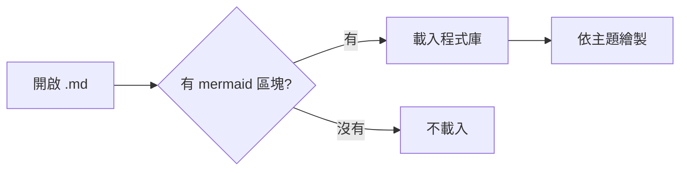
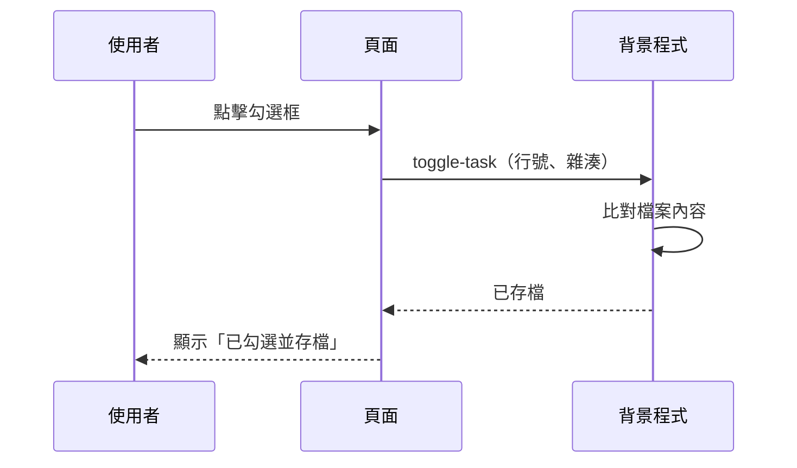
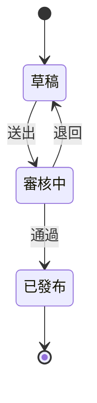
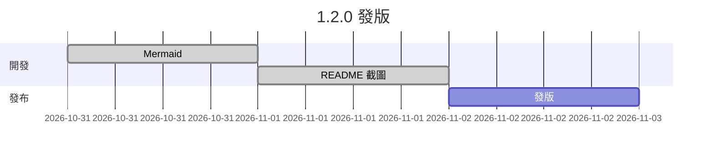
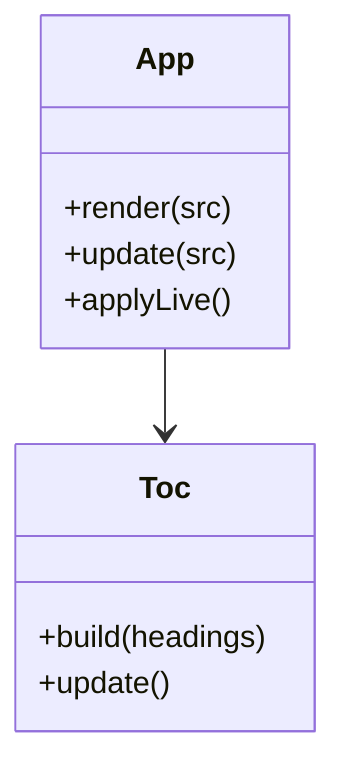
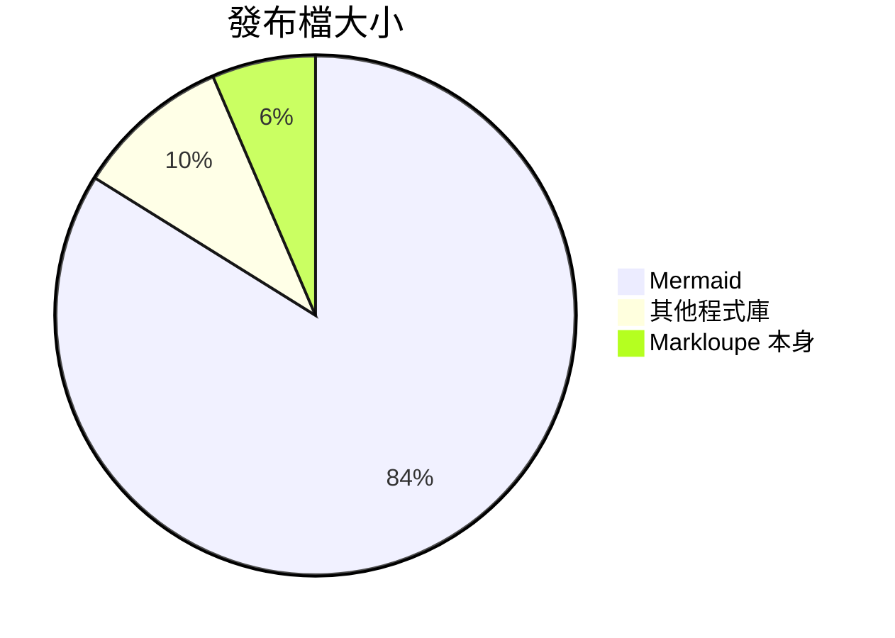

# Mermaid 圖表

> [!NOTE]
> 預期結果：下面每個 mermaid 區塊都畫成圖；最後一個故意寫錯，顯示紅色「Mermaid 語法錯誤」和原始碼。

## 檢查項目

- [ ] 開檔後約 1 秒內所有圖畫好（第一次載入程式庫稍慢屬正常）
- [ ] 中文標籤正常顯示、沒有被截斷
- [ ] 滑過圖表，右上角出現「mermaid｜原始碼｜複製」；按「原始碼」切成程式碼，再按「圖表」切回
- [ ] 按工具列的「主題」或鍵盤 `d` 切換主題，圖表跟著變成深色／淺色
- [ ] 用編輯器改一個節點文字並存檔，約 1 秒內圖更新；其他沒改的圖不閃爍
- [ ] 按圖表的「全螢幕」：滾輪縮放、拖曳移動、雙擊重設，Esc 離開
- [ ] 開啟 GitHub 上的 [demo.md](https://raw.githubusercontent.com/xjin9612/markloupe/main/docs/demo.md)：圖表有畫出來，跟隨主題
- [ ] popup →「版面預設值」取消「繪製 Mermaid 圖表」，重新整理後只剩程式碼；測完記得勾回來
- [ ] 開一份沒有 mermaid 的檔案（例如 [05-清單與表格.md](./05-清單與表格.md)），F12 → Network 篩選 `mermaid`，應該沒有任何請求

## 流程圖



## 循序圖



## 狀態圖



## 甘特圖



## 類別圖



## 圓餅圖



## 語法錯誤（預期顯示錯誤訊息）

```mermaid
flowchart TD
  A[少了右括號 --> B
```
